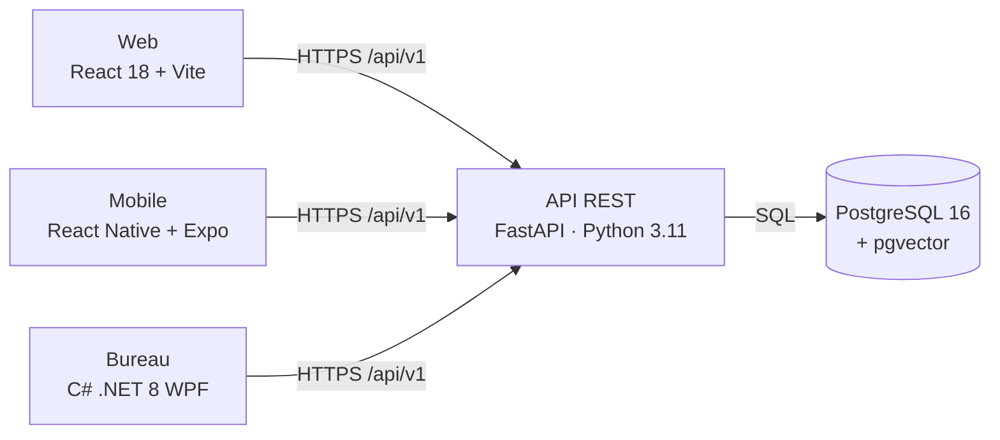

# Quincaillerie Laurentienne — Projet A

Plateforme de commerce omnicanal bilingue (FR/EN) pour une chaîne fictive de trois quincailleries des
Laurentides (Saint-Jérôme, Sainte-Agathe-des-Monts, Mont-Tremblant) : catalogue et disponibilité par
magasin, puis (jalons suivants) panier, paiement Stripe en mode test, cueillette en magasin par code QR,
gestion des stocks par le personnel et assistant « Conseiller Laurentien » fondé sur une base
documentaire approuvée. Une API REST unique sert une application web, une application mobile et une
application de bureau.

| | |
|---|---|
| **Site web** | <https://quincaillerie-laurentienne-seven.vercel.app> (Vercel) |
| **API** | <https://quincaillerie-laurentienne-api.onrender.com> — santé : [`/health`](https://quincaillerie-laurentienne-api.onrender.com/health), documentation : [`/docs`](https://quincaillerie-laurentienne-api.onrender.com/docs) (Render) |
| **Vidéo de démonstration** | À compléter |
| **Version** | L1 — Fondations, cible `v0.1.0` (étiquette non encore créée) |

## Architecture



Aucun client n'accède directement à la base : toutes les règles d'affaires et les autorisations sont
appliquées par l'API. Détails : [`docs/architecture/`](docs/architecture/) (C4 et ADR) et
[`docs/fondations/`](docs/fondations/).

| Composant | Technologies |
|---|---|
| API | FastAPI, Pydantic 2, SQLAlchemy 2, Alembic, PyJWT, Argon2id, slowapi |
| Base de données | PostgreSQL 16 + pgvector ; recherche plein texte FR/EN avec `unaccent` |
| Web | React 18, Vite 6, TypeScript, React Router 7, i18next ; Vitest |
| Mobile | React Native 0.88, Expo SDK 58 ; Jest (`jest-expo`) |
| Bureau | .NET 8, WPF, MVVM (CommunityToolkit.Mvvm) ; xUnit |
| CI/CD | GitHub Actions (`api-ci`, `web-ci`, `mobile-ci`, `desktop-ci`, `security`), Dependabot, CodeQL, Gitleaks |

## Installation locale

### Prérequis

| Outil | Version |
|---|---|
| Python | 3.11 ou plus |
| PostgreSQL | 16, avec l'extension `unaccent` (incluse) ; image Docker conseillée : `pgvector/pgvector:pg16` |
| Node.js | 20 ou plus (web et mobile) |
| .NET SDK | 8 (bureau, Windows uniquement) |

### Variables d'environnement

Copier `.env.example` en `.env` à la racine et remplir au minimum `SECRET_KEY`, `MFA_ENCRYPTION_KEY`
et `DATABASE_URL` (commandes de génération dans [`api/README.md`](api/README.md)). Le fichier `.env`
n'est jamais versionné. Chaque client a aussi son propre `.env.example` : [`web/`](web/.env.example),
[`mobile/`](mobile/.env.example) ; le bureau lit `desktop/src/QuincaillerieLaurentienne.Desktop/appsettings.json`.

### Base de données, migrations et amorçage

```bash
docker run -d --name ql-dev-db -e POSTGRES_USER=quincaillerie -e POSTGRES_PASSWORD=<mot-de-passe-local> \
  -e POSTGRES_DB=quincaillerie -p 127.0.0.1:5432:5432 pgvector/pgvector:pg16

cd api
python -m venv .venv && source .venv/bin/activate      # Windows : .venv\Scripts\activate
pip install -r requirements-dev.txt
alembic upgrade head                                  # toutes les migrations (entités Must)
python -m app.seed.seed_l1                            # 3 magasins, 157 produits, stocks (relançable)
```

### Exécution de chaque application

| Application | Commande | Adresse |
|---|---|---|
| API | `cd api && uvicorn app.main:app --reload` | http://localhost:8000/docs |
| Web | `cd web && npm ci && npm run dev` | http://localhost:5173 |
| Mobile | `cd mobile && npm ci && npx expo start` | Expo Go ou émulateur |
| Bureau | `cd desktop && dotnet run --project src/QuincaillerieLaurentienne.Desktop` | Fenêtre Windows |

Détails par application : [`api/`](api/README.md), [`web/`](web/README.md), [`mobile/`](mobile/README.md),
[`desktop/`](desktop/README.md).

## Tests

| Suite | Commande |
|---|---|
| API (PostgreSQL de test réel, port 5433) | `cd api && pytest --cov` (voir `api/README.md` pour lancer la base de test) |
| Web | `cd web && npm run lint && npm run typecheck && npm test && npm run build` |
| Mobile | `cd mobile && npm run typecheck && npm test` |
| Bureau | `cd desktop && dotnet test -c Release --filter "Category!=Integration"` |
| Intégration mobile et bureau contre une API réelle | voir `mobile/README.md` et `desktop/README.md` |
| Test de charge et de concurrence (50 acheteurs sur 5 unités) | **Prévu au L2** (réservations de stock) |

Les mêmes suites sont exécutées par les workflows GitHub Actions de chaque application.

## Déploiement

**État : déployé (offres gratuites).**

| Composant | Hébergeur | URL | Déploiement |
|---|---|---|---|
| Base de données | Neon (PostgreSQL 16, US East) | — (privée) | Migrations Alembic au démarrage de l'API |
| API | Render (Blueprint `render.yaml`) | <https://quincaillerie-laurentienne-api.onrender.com> | Automatique à chaque fusion sur `main` |
| Web | Vercel (dossier `web`) | <https://quincaillerie-laurentienne-seven.vercel.app> | Automatique à chaque fusion sur `main` |

Le site appelle `/api/v1` sur son propre domaine ; Vercel relaie vers Render (`web/vercel.json`). Les
clients mobile et bureau se branchent sur l'API publique avec `EXPO_PUBLIC_API_BASE_URL` et
`QL_API_BASE_URL`. L'offre gratuite de Render met l'API en veille après 15 minutes d'inactivité :
la première requête peut prendre environ une minute.

Procédure, variables, migrations, amorçage, redéploiement et limites :
[`docs/deploiement/deploiement-l1.md`](docs/deploiement/deploiement-l1.md). Les secrets sont saisis
uniquement dans les tableaux de bord des hébergeurs ; aucun n'est dans le dépôt. Les identifiants des
comptes de démonstration sont transmis en privé au responsable du projet (cahier §6.3).

## Équipe, documentation et licence

| | |
|---|---|
| **Membres et rôles** | À compléter (MIKE08-CODE : responsable du dépôt et des fusions) |
| **Documentation** | [`docs/`](docs/) — vision et exigences, architecture et ADR, modèle de données, modèle de menaces, contrat d'API, gestion de projet |
| **Cahier des charges** | Non publié dans le dépôt (document de cours) |
| **Licence** | À compléter (projet scolaire) |
