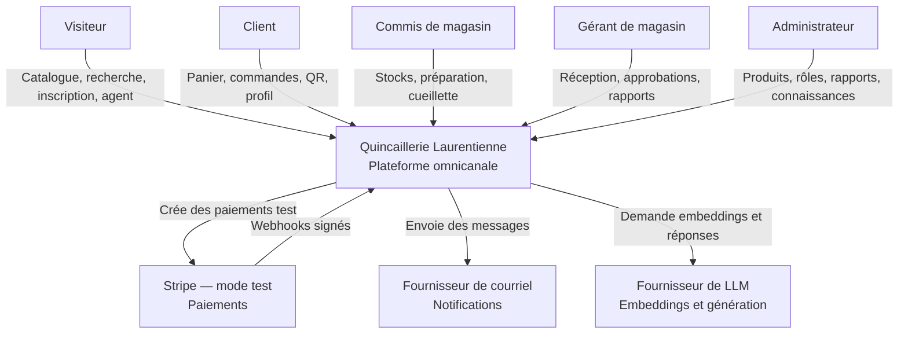
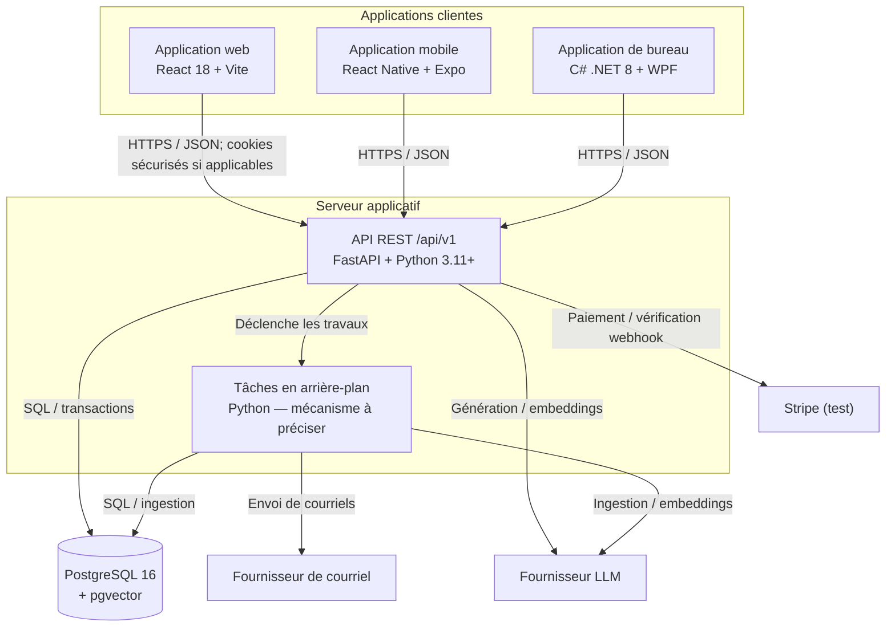
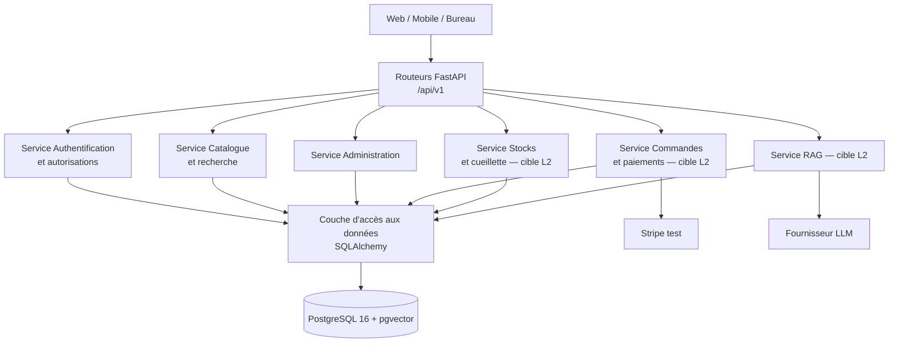
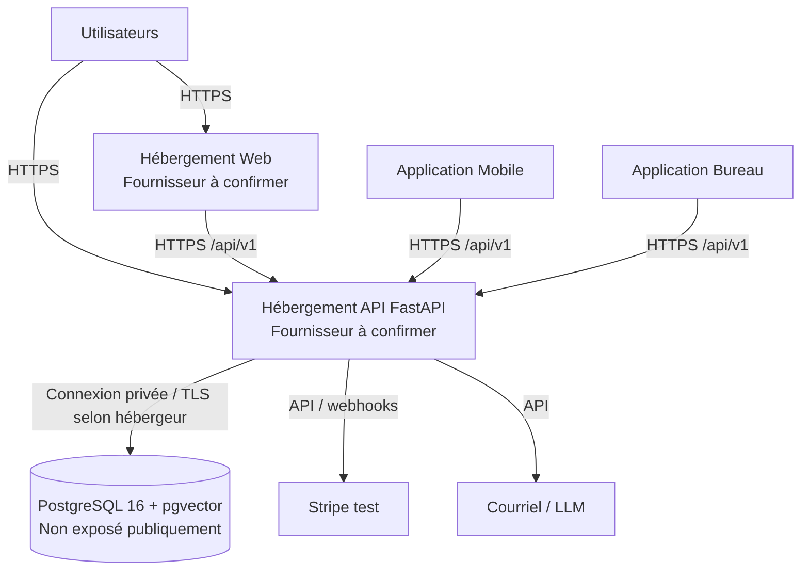

# Document d'architecture — Quincaillerie Laurentienne (Projet A)

| Champ | Valeur |
|---|---|
| Livrable | L1 — Fondations (cible applicative `v0.1.0`) |
| Version du document | 1.2 — état de réalisation et ADR 004 à 008 (21 novembre 2026) |
| Auteur | [à compléter] |
| Approbateur | [à compléter] |
| Statut | Proposition à valider |
| Référence | Cahier des charges — Projet A, notamment architecture commune, exigences du Projet A et livrables L1 |

> **Portée de la révision.** La structure initiale en quatre sections, les choix technologiques, les trois clients, l'API centrale, PostgreSQL et les trois décisions ADR sont conservés. Les diagrammes sont réécrits en Mermaid; les précisions ajoutées décrivent l'**architecture cible** et ne prouvent pas que les fonctionnalités sont déjà implémentées.

Le système suit une architecture à un serveur applicatif et trois clients : l'API REST versionnée (`/api/v1`) est consommée par l'application web, l'application mobile et l'application de bureau. Aucun client n'accède directement à la base de données. Toutes les règles d'affaires et toutes les décisions d'autorisation sont appliquées par le serveur; les clients ne sont jamais considérés comme fiables.

## 1. Contexte du système (C4 niveau 1)

| Élément | Rôle |
|---|---|
| Visiteur | Non authentifié : catalogue, disponibilité par magasin, agent, création de compte. |
| Client | Panier, paiement, commandes, code QR de cueillette, profil et vie privée. |
| Commis de magasin | Stocks de son magasin, préparation des commandes, validation des cueillettes. |
| Gérant de magasin | Permissions du commis, réception, approbation des ajustements, rapports du magasin. |
| Administrateur | Produits, prix, promotions, utilisateurs et rôles, rapports, base de connaissances. |
| Stripe (mode test) | Paiement; confirmation de commande uniquement après vérification d'un webhook signé. |
| Fournisseur de courriel | Vérification du compte, réinitialisation du mot de passe, confirmations et avis de cueillette. |
| Fournisseur de LLM | Embeddings et génération des réponses de l'agent. |

**Lecture du diagramme :** le rectangle central représente le système à construire; les acteurs et services externes sont hors de sa frontière de confiance.

## 2. Conteneurs (C4 niveau 2)

| Conteneur | Technologie | Responsabilités |
|---|---|---|
| Application web | React 18, Vite, React Router, i18next | Boutique, espace client, administration, widget de clavardage; FR/EN. |
| Application mobile | React Native + Expo | Catalogue, panier, suivi de commande, code QR consultable hors ligne après chargement, notifications. |
| Application de bureau | C# .NET 8, WPF, MVVM | Stocks, réception, préparation, validation de cueillette par QR. |
| API | FastAPI, Python 3.11+, Pydantic, SQLAlchemy 2, Alembic | Authentification, autorisation (rôle et propriété), règles d'affaires, prix et taxes, réservations, webhooks Stripe, pipeline RAG. |
| Tâches en arrière-plan | Python | Expiration des réservations (15 min), courriels, ingestion du RAG. **Mode d'exécution et reprise à confirmer.** |
| Base de données | PostgreSQL 16 + pgvector | Données relationnelles, transactions, contraintes, recherche plein texte et vecteurs des documents. |

**Décision de conception liée au RAG :** la base de connaissances de l'agent ne contient jamais de renseignements personnels sur les clients. L'agent répond à partir de documents approuvés de politique et de guides publics ou internes; les prix et disponibilités en temps réel viennent de l'API métier, et non de la base documentaire. Le contrôle de ces frontières doit être testé.

### 2.1. Composants internes de l'API (C4 niveau 3 — précision ajoutée)

Ce schéma est **logique** : les noms des services ne présument pas des noms de fichiers ou classes présents dans le dépôt. La séparation entre routeurs, logique métier et persistance doit être vérifiée lors de l'implémentation. L1 porte principalement sur l'authentification, le catalogue et l'administration des produits; les modules transactionnels et RAG sont prévus pour les jalons suivants.

## 3. Choix technologiques

| Besoin | Choix conservé | Justification et précision |
|---|---|---|
| API | FastAPI | API REST versionnée, documentation OpenAPI automatique et validation des entrées par Pydantic. L'asynchronisme est possible, sans être automatique pour toute opération. |
| ORM et migrations | SQLAlchemy 2.x + Alembic | Schéma versionné et migrations reproductibles; requêtes paramétrées pour limiter le risque d'injection SQL. |
| Base de données | PostgreSQL 16 + pgvector | Transactions, verrouillage de lignes, contraintes, JSONB, recherche plein texte et vectorielle. |
| Authentification | JWT d'accès court (≤ 15 min), rafraîchissement en cookie httpOnly pour le Web, Argon2id, MFA TOTP du personnel | Durée limitée et révocation/rotation réduisent l'exposition; **un JWT ne prévient pas à lui seul le vol de jeton**. Stockage mobile/bureau à adapter aux plateformes (ADR-002). |
| Web | React 18 + Vite, React Router, i18next | Interface bilingue et navigation côté client. |
| Mobile | React Native + Expo (ADR-003) | Compétences React réutilisables, stockage sécurisé et notifications selon capacités de la plateforme. |
| Bureau | C# .NET 8, WPF, MVVM | Interface Windows et séparation vue/logique facilitant les tests. |
| Paiements | Stripe (mode test), Checkout ou Payment Intents, webhooks | Simulation de paiement sans manipulation directe de données de carte; vérification de signature et idempotence indispensables. |
| RAG | pgvector, embeddings et modèle de clavardage d'un fournisseur de LLM | Recherche documentaire vectorielle; séparation des connaissances et données métier en temps réel. |
| Verrouillage du stock | `SELECT ... FOR UPDATE` (ADR-001) | Prévention de la survente dans des transactions courtes et contrôlées. |

## 4. Architecture Decision Records

Les trois décisions initiales sont **conservées**. Leur statut demeure **Proposé** jusqu'à approbation explicite. Les ADR 004 à 008, ajoutés au L1, sont dans [`docs/adr/`](../adr/).

| ADR | Sujet | Décision | Statut |
|---|---|---|---|
| ADR-001 | Stratégie de verrouillage du stock | Verrouillage pessimiste dans une transaction courte. | Proposé |
| ADR-002 | Stockage des jetons d'authentification | Accès en mémoire; rafraîchissement en cookie httpOnly sur le Web. | Proposé |
| ADR-003 | Cadre de l'application mobile | React Native + Expo. | Proposé |
| ADR-004 | Marques | Entité dédiée `brands`, sans duplication du nom ([fichier](../adr/0004-marques-entite-dediee.md)). | Accepté (D2) |
| ADR-005 | Stocks | Grand livre signé en ajout seulement ([fichier](../adr/0005-grand-livre-des-stocks.md)). | Accepté (D3) |
| ADR-006 | Recherche plein texte | Colonne générée + configurations `*_unaccent` ([fichier](../adr/0006-recherche-plein-texte.md)). | Accepté (O9) |
| ADR-007 | React 19 sur le mobile | Imposé par Expo SDK 58 ; web en React 18 ([fichier](../adr/0007-react-19-mobile-expo.md)). | Proposé |
| ADR-008 | Format des erreurs | `ErrorOut` et `X-Request-ID` ([fichier](../adr/0008-format-uniforme-des-erreurs.md)) — non implémenté. | Accepté (D1), à réaliser |

### ADR-001 — Stratégie de verrouillage du stock

- **Contexte :** plusieurs clients peuvent acheter simultanément les dernières unités d'un produit dans un magasin.
- **Options examinées :** verrouillage pessimiste (`SELECT ... FOR UPDATE`) ou verrouillage optimiste avec version.
- **Décision proposée :** conserver le verrouillage pessimiste dans une transaction SQL courte, pour vérifier et réserver les quantités avant validation.
- **Justification :** les accès concurrents au même stock sont sérialisés pendant la modification; cela facilite le respect de la quantité disponible.
- **Conséquences :** risque d'attente ou d'interblocage si les transactions durent trop longtemps; ordre de verrouillage stable, délais d'attente et tests de concurrence à prévoir.
- **Validation :** test de 50 acheteurs simultanés sur 5 unités, avec exactement 5 achats/réservations réussis selon le scénario du cahier des charges.
- **Statut :** Proposé.

### ADR-002 — Stockage des jetons d'authentification

- **Contexte :** les trois clients doivent s'authentifier sans exposer inutilement les jetons.
- **Options examinées :** stockage persistant accessible au JavaScript, cookies sécurisés, stockage sécurisé propre aux applications natives.
- **Décision proposée :** jeton d'accès court en mémoire; pour le **Web**, jeton de rafraîchissement en cookie `httpOnly`, `Secure`, `SameSite` configuré selon le flux. Pour le **Mobile** et le **Bureau**, utiliser un stockage sécurisé propre à la plateforme; mécanisme exact à valider lors de leur implémentation.
- **Justification :** réduire l'accès aux jetons par le code applicatif et limiter leur durée d'exposition.
- **Conséquences :** prévoir rotation et révocation des rafraîchissements, protection CSRF lorsque des cookies sont utilisés, gestion de session et déconnexion sur chaque client. `httpOnly` ne supprime pas tous les risques XSS/CSRF.
- **Validation :** tests d'expiration, rafraîchissement, révocation, déconnexion, accès non autorisé et protection CSRF applicable.
- **Statut :** Proposé.

### ADR-003 — Cadre de l'application mobile

- **Contexte :** le client mobile doit partager les contrats de l'API avec le Web, gérer l'authentification et présenter les produits et codes QR.
- **Options examinées :** React Native + Expo et .NET MAUI.
- **Décision proposée :** conserver React Native + Expo.
- **Justification :** cohérence des compétences avec React et outillage Expo pour les fonctionnalités mobiles.
- **Conséquences :** dépendance à l'écosystème Expo; vérifier la compatibilité des modules natifs requis, le stockage sécurisé, la consultation hors ligne du QR et les notifications.
- **Validation :** démarrage de l'application, authentification sécurisée, connexion à l'API déployée, liste de produits et tests sur plateformes cibles.
- **Statut :** Proposé.

## 5. Architecture de sécurité (complément)

La frontière de confiance principale se situe **entre les clients et l'API**. Les clients n'accèdent ni directement à PostgreSQL ni aux secrets serveur.

| Contrôle | Application architecturale |
|---|---|
| Transport | HTTPS pour les communications externes; politique CORS limitée aux origines autorisées du Web. |
| Authentification | Argon2id, jetons courts, rafraîchissement révocable, MFA TOTP pour le personnel selon le jalon prévu. |
| Autorisation | Vérification serveur des rôles, de la propriété des ressources et du magasin d'affectation. |
| Entrées et sorties | Validation Pydantic, requêtes SQL paramétrées, erreurs sans divulgation de secrets. |
| Paiements | Webhooks Stripe signés et traitement idempotent; aucune confiance dans une confirmation transmise uniquement par le client. |
| Secrets | Variables d'environnement ou gestionnaire de secrets; aucun secret dans Git. |
| Vie privée et RAG | Documents approuvés, sans renseignements personnels; séparation entre récupération documentaire et consultation des données métier. |
| Observabilité | Journalisation structurée sans secrets ni renseignements personnels; contrôle de santé `/health`. |

Ces contrôles constituent la **conception cible**. Leur présence effective doit être confirmée par tests et revue du code; le modèle de menaces STRIDE est traité dans un livrable distinct.

## 6. Déploiement et environnements (complément)

- **Local :** API et base de test, avec procédure d'installation documentée dans le README; les trois clients sont exécutés dans leurs environnements de développement respectifs.
- **Démonstration L1 :** Web et API accessibles sur des URL de test; clients Mobile et Bureau configurés pour joindre l'API de démonstration.
- **Environnements ultérieurs :** séparation des secrets et données entre développement, test et déploiement; aucun identifiant de test ne doit être réutilisé en production.
- **Migrations et sauvegardes :** migrations Alembic versionnées, procédure de sauvegarde/restauration à documenter et tester selon les exigences non fonctionnelles.
- **Tâches en arrière-plan :** stratégie d'ordonnancement, reprise sur erreur et supervision **à décider** avant l'implémentation des réservations, courriels et ingestion RAG.
- **Hébergement et CI/CD :** fournisseur, stratégie de publication et noms d'URL **à confirmer**; aucun service précis n'est présumé déployé.

## 7. État de réalisation et validation (complément)

| Élément | Architecture décrite | État d'implémentation dans ce document |
|---|---|---|
| API FastAPI et authentification | Oui | **Fusionné** sur `main` (PR #21) ; 119 tests ; CI verte |
| Catalogue et administration | Oui | **En PR** #29 (API ; CI verte ; 329 tests locaux) |
| Web React/Vite | Oui | **En PR** #30 (React 18 + Vite 6 ; CI `web-ci` verte) |
| Mobile React Native/Expo | Oui | **En PR** #31 (Expo SDK 58, React 19 — ADR-007 ; CI `mobile-ci` verte) |
| Bureau WPF/.NET 8 | Oui | **En PR** #32 (MVVM ; CI `desktop-ci` verte) |
| Paiement, stocks et cueillette | Oui, cible des jalons suivants | Tables créées (PR #29) ; aucune route (L2) |
| RAG | Oui, cible des jalons suivants | Non commencé |
| Déploiement public | Cible décrite | **Non déployé** ; procédure Neon + Render + Vercel préparée (PR #33) |

État au 21 novembre 2026 : « en PR » signifie poussé, contrôles GitHub au vert, **non fusionné**.

**Preuves attendues pour la validation L1 :** contrat OpenAPI versionné, migrations reproductibles, tests d'authentification/catalogue/administration, données d'amorçage (trois magasins et au moins 150 produits), connexion des trois clients à l'API de démonstration, résultats CI et liens de déploiement. Les preuves seront ajoutées sans confondre architecture et état d'avancement.

## 8. Historique et points à valider (complément)

| Version | Modification |
|---|---|
| Initiale | Document de six pages : contexte C4, conteneurs C4, choix technologiques et tableau de trois ADR. |
| 1.1 | Diagrammes convertis en Mermaid; ajout du C4 composants, détail des ADR, sécurité, déploiement et traçabilité, sans changer les choix initiaux. |
| 1.2 | État de réalisation réel (PR #21, #29 à #33) ; ADR 004 à 008 ajoutés dans `docs/adr/` ; ADR 001 à 003 inchangés. |

**Décisions ouvertes :** auteur et approbateur; approbation des ADR; hébergeur et URL de démonstration; mécanisme des tâches asynchrones; stockage et rafraîchissement des jetons Mobile/Bureau; preuves de conformité de l'implémentation.
