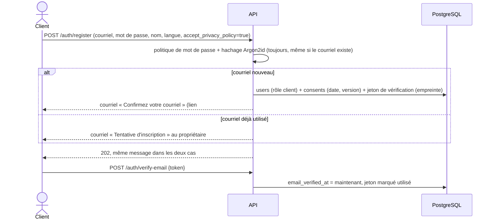
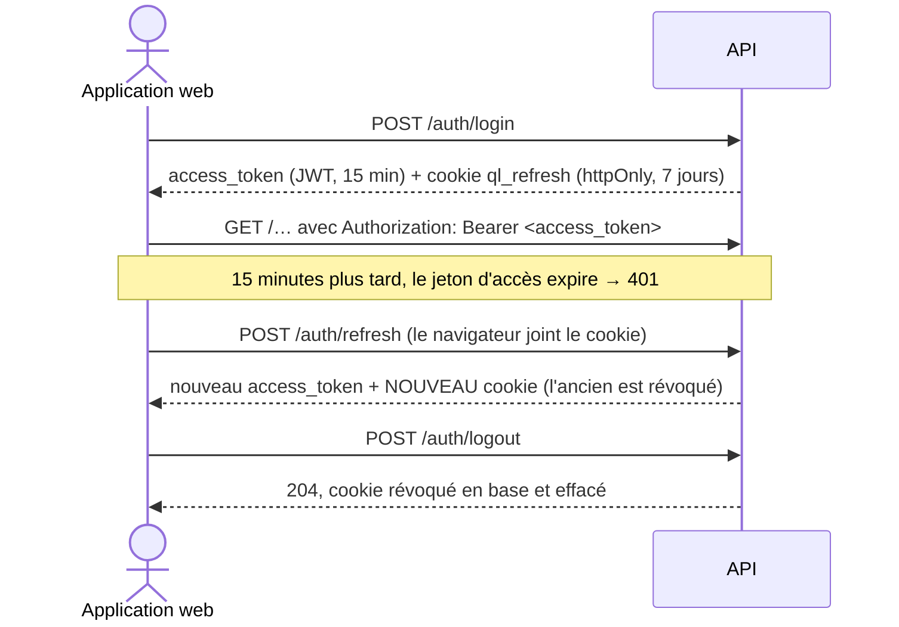
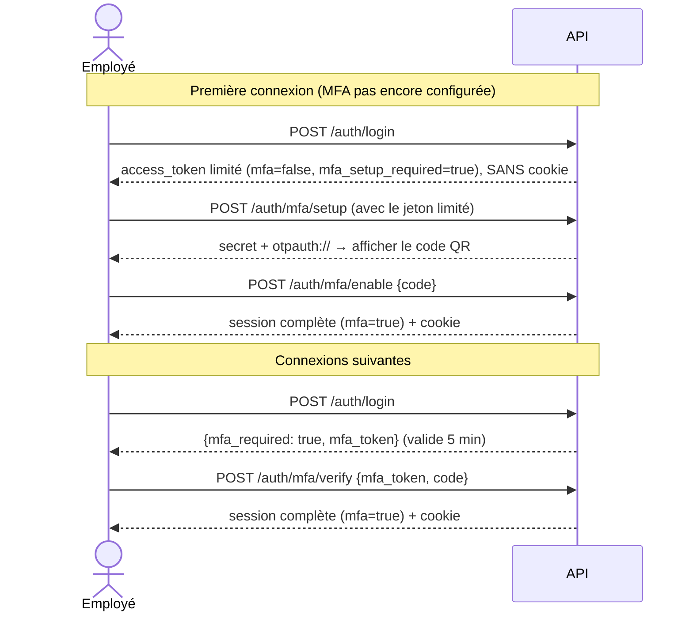

# Module d'authentification (A.4.1)

Ce document explique le code de l'authentification de l'API : où il se trouve, comment il
fonctionne et pourquoi il est écrit ainsi. Il couvre les exigences **A-AUTH-01 à A-AUTH-07** du
cahier des charges. A-AUTH-08 (connexion Google, priorité « Could ») n'est pas réalisée.

> Pour essayer l'API : `cd api && source .venv/bin/activate && uvicorn app.main:app --reload --port 8001`,
> puis ouvrir http://localhost:8001/docs. Chaque route y est décrite.

---

## 1. Où est le code

L'API suit l'architecture en couches du cahier (section 4.2, ENF-11). Une requête traverse les
couches de haut en bas, et **chaque couche ne parle qu'à celle du dessous**.

```
routers/  →  schemas/  →  services/  →  repositories/  →  models/  →  PostgreSQL
 (HTTP)      (format)     (règles)      (requêtes SQL)     (tables)
```

| Fichier | Rôle | À lire si… |
|---|---|---|
| `api/app/api/v1/routers/auth.py` | Les 12 routes `/api/v1/auth/*`. Aucune règle métier : lit la requête, appelle le service, pose le cookie. | tu cherches une URL |
| `api/app/schemas/auth.py` | Format des données reçues et renvoyées (Pydantic). Les descriptions apparaissent dans Swagger. | tu veux savoir quels champs envoyer |
| `api/app/services/auth_service.py` | **Toutes les règles** : inscription, connexion, verrouillage, jetons, réinitialisation. | tu veux comprendre une règle |
| `api/app/services/mfa_service.py` | Configuration et vérification des codes TOTP. | MFA |
| `api/app/services/password_policy.py` | Politique de mot de passe (12 caractères, liste noire…). | A-AUTH-03 |
| `api/app/services/email_service.py` | Courriels (affichés dans le terminal en développement). | |
| `api/app/repositories/*.py` | Requêtes SQL (SQLAlchemy). Aucune décision. | |
| `api/app/models/*.py` | Tables : `users`, `consents`, `stores`, `staff_assignments`, `refresh_tokens`, `one_time_tokens`. | |
| `api/app/api/deps.py` | **Contrôle d'accès** réutilisé par tout le projet (`get_current_user`, `require_roles`…). | tu protèges une nouvelle route |
| `api/app/core/security.py` | Cryptographie : Argon2id, JWT, SHA-256, Fernet, TOTP. | |
| `api/app/core/config.py` | Réglages lus dans `.env` (durées, clés…). Refuse de démarrer si un réglage est dangereux. | |
| `api/app/core/errors.py` | Erreurs métier → réponse `{"detail": {"code", "message"}}`. | |
| `api/app/core/rate_limit.py` | Limitation de débit par adresse IP (slowapi). | A-AUTH-07 |
| `api/app/core/security_log.py` | Journal des événements de sécurité (sans renseignements personnels). | |
| `api/app/main.py` | Assemble l'application : CORS, en-têtes de sécurité, format des erreurs, Swagger. | |
| `api/alembic/versions/` | Migrations de la base. | |
| `api/tests/` | 119 tests, un fichier par exigence. | |

---

## 2. Les parcours

### 2.1 Inscription et confirmation du courriel (A-AUTH-01)



Un compte non vérifié peut se connecter, mais pas commander. La dépendance
`require_verified_email` (dans `deps.py`) est prête pour le module des commandes.

### 2.2 Connexion, rafraîchissement, déconnexion (A-AUTH-02)



**Deux jetons, deux rôles :**

| | Jeton d'accès | Jeton de rafraîchissement |
|---|---|---|
| Format | JWT signé (HS256) | Chaîne aléatoire de 256 bits |
| Durée | 15 min (imposé par `config.py`) | 7 jours, et 30 jours max. par session |
| Stockage côté client | En mémoire (variable JavaScript) | Cookie httpOnly : JavaScript ne peut pas le lire |
| Stockage en base | Rien (sans état) | Empreinte SHA-256 seulement |
| Révocable | Non (il expire vite) | Oui |

**Rotation et détection de vol :** à chaque `/refresh`, le jeton présenté est révoqué et un nouveau est
émis. Si un jeton déjà révoqué revient, quelqu'un l'a copié : **toutes les sessions** de l'utilisateur
sont fermées et l'événement est journalisé.

### 2.3 Connexion du personnel avec MFA (A-AUTH-06)



Le jeton d'accès contient `mfa: true/false`. `get_current_user` (dans `deps.py`) **refuse tout
jeton du personnel avec `mfa=false`** (403 `mfa_required`). Seules `/mfa/setup` et `/mfa/enable`
acceptent un jeton limité (`get_principal`).

### 2.4 Réinitialisation du mot de passe (A-AUTH-04)

1. `POST /auth/password/forgot {email}` → toujours **202 avec le même message**. Un courriel n'est
   envoyé que si le compte existe (lien `#token=…`, **30 min**, usage unique). Une nouvelle demande
   annule l'ancien lien.
2. `POST /auth/password/reset {token, new_password}` → le mot de passe est changé, le jeton est
   consommé, **toutes les sessions sont fermées**, et les jetons d'accès déjà émis sont refusés
   (colonne `users.tokens_valid_after`).

### 2.5 Verrouillage (A-AUTH-07)

Deux protections complémentaires :

| | Limitation de débit | Verrouillage progressif |
|---|---|---|
| Par | adresse IP | compte |
| Contre | un robot qui essaie beaucoup de comptes | quelqu'un qui devine le mot de passe d'un compte |
| Règle | p. ex. 10 connexions/min | 5 échecs → 15 min, 10 → 30 min, 15 → 60 min (max. 24 h) |
| Réponse | 429 `rate_limited` | 423 `account_locked` + `Retry-After` |
| Code | `core/rate_limit.py` | `register_failed_attempt()` dans `auth_service.py` |

Les mauvais codes MFA comptent aussi dans le verrouillage. Démonstration : `pytest tests/test_lockout.py -v`.

---

## 3. Contrôle d'accès : protéger une nouvelle route (A-AUTH-05)

Toute nouvelle route protégée du projet utilise les dépendances de `api/app/api/deps.py` :

```python
from app.api.deps import get_current_user, require_roles, require_store_access, require_verified_email
from app.models import UserRole

@router.get("/orders/mine")                       # tout utilisateur connecté
def my_orders(user: User = Depends(get_current_user)): ...

@router.post("/orders/{id}/pay")                  # client au courriel vérifié (A-AUTH-01)
def pay(user: User = Depends(require_verified_email)): ...

@router.get("/reports")                           # gérant ou administrateur
def reports(user: User = Depends(require_roles(UserRole.MANAGER, UserRole.ADMIN))): ...

@router.post("/stores/{store_id}/inventory")      # personnel de CE magasin, ou administrateur
def adjust(store_id: UUID, user: User = Depends(require_store_access)): ...
```

**Deux règles à ne pas oublier :**
1. Ces dépendances vérifient le **rôle**. La **propriété** (« cette commande appartient-elle à cet
   utilisateur? ») se vérifie dans le service, avec le `user` reçu (ENF-04, tests IDOR).
2. Ajouter la nouvelle route à la matrice de `api/tests/test_rbac.py`, avec le code attendu pour les
   5 rôles. C'est le critère d'acceptation d'A-AUTH-05.

Le rôle n'est **pas** stocké dans le jeton : il est relu en base à chaque requête. Un changement de
rôle ou une désactivation de compte s'applique donc immédiatement.

---

## 4. Codes d'erreur (pour le web et le mobile)

Toutes les erreurs ont la forme `{"detail": {"code": "...", "message": "..."}}`. Le `message` est en
français. Les applications doivent **traduire le `code`** dans leurs fichiers i18n (ENF-10).

| Code | HTTP | Signification |
|---|---|---|
| `validation_error` | 422 | Format invalide; `detail.errors` liste les champs fautifs |
| `password_too_short` / `password_too_long` | 422 | Moins de 12 ou plus de 128 caractères |
| `password_too_common` | 422 | Mot de passe dans la liste des mots de passe courants |
| `password_too_simple` | 422 | Trop répétitif (p. ex. `abababababab`) |
| `password_contains_personal_info` | 422 | Contient le courriel, le nom ou « quincaillerie » |
| `invalid_credentials` | 401 | Courriel ou mot de passe invalide |
| `account_locked` | 423 | Compte bloqué; voir l'en-tête `Retry-After` |
| `not_authenticated` / `invalid_token` | 401 | Jeton d'accès absent, expiré ou invalide |
| `invalid_refresh_token` | 401 | Session expirée : se reconnecter |
| `mfa_required` | 403 | Personnel sans MFA complétée |
| `insufficient_role` | 403 | Rôle insuffisant |
| `store_access_denied` | 403 | Pas affecté à ce magasin |
| `email_not_verified` | 403 | Courriel à confirmer avant de commander |
| `invalid_or_expired_token` | 400 | Lien de courriel invalide, utilisé ou expiré |
| `invalid_mfa_code` / `invalid_mfa_token` | 401 | Code MFA faux, ou défi MFA expiré |
| `mfa_already_enabled` / `mfa_setup_required` | 409 / 400 | Ordre des étapes MFA non respecté |
| `rate_limited` | 429 | Trop de requêtes depuis cette adresse IP |

---

## 5. Choix de sécurité, et pourquoi

| Choix | Pourquoi | Référence |
|---|---|---|
| Argon2id, mots de passe normalisés en NFKC | Hachage lent et résistant aux cartes graphiques; « é » identique sur Mac et Windows | A-AUTH-03, ENF-02, NIST 800-63B |
| Le hachage est calculé même quand le courriel existe déjà, et un faux hachage quand il n'existe pas | Le temps de réponse ne révèle pas quels comptes existent | A-AUTH-04 (énumération) |
| Mêmes messages, que le compte existe ou non | Aucune énumération d'utilisateurs | A-AUTH-04 |
| Jetons stockés sous forme d'empreinte SHA-256 | Une fuite de la base ne donne aucun jeton utilisable | OWASP A02 |
| Liens de courriel avec `#token=` (et non `?token=`) | Le navigateur n'envoie jamais ce qui suit `#` au serveur : le jeton ne finit pas dans les journaux | OWASP A09 |
| Cookie `httpOnly; Secure; SameSite=Strict; Path=/api/v1/auth` | Illisible par JavaScript (XSS), HTTPS seulement, non envoyé par un autre site (CSRF), seulement aux routes d'auth | A-AUTH-02 |
| Rôle relu en base, jamais lu dans le jeton ni dans la requête | Le client n'est jamais cru (`extra="forbid"` refuse un champ `role`) | ENF-04, OWASP A01 |
| Secret MFA chiffré (Fernet), clé dans `.env` | Une fuite de la base ne donne pas les secrets MFA | Annexe D, A02 |
| Un code TOTP ne sert qu'une fois | Un code intercepté ne peut pas être rejoué | A-AUTH-06 |
| Erreurs 422 sans les valeurs reçues | Un mot de passe mal formé n'est jamais renvoyé dans la réponse | A-AUTH-03 |
| `Cache-Control: no-store` sur `/api/*` | Aucun cache ne garde de jeton ni de donnée personnelle | OWASP |
| Journal `app.security` : UUID seulement, jamais de courriel | Enquêter sur une attaque sans exposer les personnes | Annexe D A09, ENF-13, Loi 25 |
| Config refusée en production si `SECRET_KEY` est faible ou si CORS vaut `*` | Impossible de déployer avec un réglage dangereux | ENF-02, ENF-03, OWASP A05 |

---

## 6. Correspondance exigence → test

| Exigence | Critère d'acceptation | Test |
|---|---|---|
| A-AUTH-01 | Compte non vérifié ne peut pas commander; date du consentement enregistrée | `tests/test_register.py` |
| A-AUTH-02 | Jeton expiré → 401; rafraîchissement OK; jeton révoqué rejeté | `tests/test_tokens.py` |
| A-AUTH-03 | Mots de passe faibles refusés clairement; rien en clair en BD ni dans les journaux | `tests/test_password_policy.py`, `tests/test_security_hardening.py` |
| A-AUTH-04 | Réutilisation du jeton impossible; aucune énumération | `tests/test_password_reset.py` |
| A-AUTH-05 | Tests pour chaque rôle sur chaque route protégée | `tests/test_rbac.py` (matrice 5 rôles × 8 routes) |
| A-AUTH-06 | Personnel sans MFA refusé | `tests/test_mfa.py` |
| A-AUTH-07 | Démontré par un script de test | `tests/test_lockout.py` |

Lancer les tests : `cd api && pytest --cov` (base de test Docker sur le port 5433, voir `api/README.md`).

---

## 7. Limites connues et points à décider

- **Mobile et bureau** : le cookie convient au web. Le cahier demande SecureStore pour le mobile
  (A.8.2) et un jeton en mémoire pour le bureau (A.8.3) : il faudra leur remettre le jeton de
  rafraîchissement autrement (p. ex. dans le corps de la réponse). À trancher dans l'ADR-002.
- **Web et API sur deux domaines en production** (Vercel / Render) : `SameSite=Strict` empêchera
  l'envoi du cookie. Solutions : `REFRESH_COOKIE_SAMESITE=none`, ou faire passer `/api` par le domaine du web.
- **Le 423 révèle qu'un compte existe** : compromis courant entre sécurité et clarté pour
  l'utilisateur, à mentionner dans le modèle de menaces.
- **Deux onglets qui rafraîchissent en même temps** : le second peut être pris pour un vol et fermer la
  session. Le web doit centraliser le rafraîchissement (un seul appel à la fois).
- **Limitation de débit en mémoire** : en production avec plusieurs instances, utiliser Redis
  (`storage_uri` dans `core/rate_limit.py`) et lancer uvicorn avec `--proxy-headers` pour obtenir la vraie IP.
- **Première configuration de la MFA** : tant qu'un employé n'a pas configuré sa MFA, son mot de passe
  seul suffit pour la configurer. Les comptes du personnel doivent donc être activés rapidement.
- **Pas encore fait** : création des comptes du personnel par un administrateur (A-ADM-02),
  réinitialisation de la MFA par un administrateur, vrai fournisseur de courriel, journaux JSON avec
  identifiant de requête (ENF-13), table `audit_logs`, connexion Google (A-AUTH-08).
