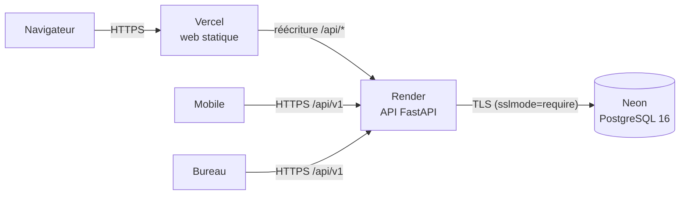

# Déploiement L1 — procédure préparée (non exécutée)

**État au 2026-11-21 : rien n'est déployé.** Aucun compte d'hébergement n'est relié au dépôt, aucun
service n'est activé et aucun secret n'est versionné. Ce document et les fichiers `render.yaml` et
`web/vercel.json` préparent le déploiement ; chaque étape marquée 🔐 exige une action et une
autorisation du responsable du projet.

Hébergement **provisoire** retenu en planification (à confirmer, offres gratuites) :

| Composant | Hébergeur | Rôle |
|---|---|---|
| Base de données | Neon (PostgreSQL 16) | Base de production ; extensions `unaccent` (requise) et `vector` (L2) |
| API | Render (service web Python) | FastAPI ; migrations et amorçage au démarrage |
| Web | Vercel (site statique Vite) | Application web ; `/api/*` relayé vers l'API (même origine) |
| Mobile, bureau | — | Configurés pour l'URL publique de l'API (aucun hébergement) |

## 1. Base de données (Neon) 🔐

1. Créer un projet PostgreSQL **16** dans la région la plus proche (Canada si offerte).
2. Vérifier les extensions **avant** la première migration :
   `SELECT name, default_version FROM pg_available_extensions WHERE name IN ('unaccent', 'vector');`
   La migration `c4a1e7d2b9f0` exécute `CREATE EXTENSION IF NOT EXISTS unaccent` : le rôle utilisé doit
   en avoir le droit. **À vérifier sur Neon** (non vérifié à ce jour).
3. Récupérer la chaîne de connexion et la convertir au pilote de l'API :
   `postgresql+psycopg://<utilisateur>:<mot-de-passe>@<hôte>/<base>?sslmode=require`.
   Elle est **secrète** : elle va uniquement dans la variable `DATABASE_URL` de Render.

## 2. API (Render) 🔐

Le fichier [`render.yaml`](../../render.yaml) décrit le service (Blueprint Render) :

- `rootDir: api`, build `pip install -r requirements.txt`, Python 3.11.
- Démarrage : `alembic upgrade head` → `python -m app.seed.seed_l1 --allow-production` →
  `uvicorn … --proxy-headers`. L'amorçage est **idempotent** : il ne crée rien s'il a déjà été appliqué.
- Contrôle de santé : `/health`.
- `autoDeploy: true` sur `main` : **chaque fusion sur `main` redéploie l'API** (déploiement automatique).

Variables à renseigner dans le tableau de bord Render (jamais dans Git) :

| Variable | Valeur | Secrète |
|---|---|---|
| `APP_ENV` | `production` (déjà dans `render.yaml`) | Non |
| `DATABASE_URL` | Chaîne Neon convertie (étape 1) | **Oui** |
| `SECRET_KEY` | Générée par Render (`generateValue`) | **Oui** |
| `MFA_ENCRYPTION_KEY` | `python -c "from cryptography.fernet import Fernet; print(Fernet.generate_key().decode())"` | **Oui** |
| `CORS_ORIGINS` | URL du site Vercel (p. ex. `https://<projet>.vercel.app`) | Non |
| `WEB_BASE_URL` | Même URL (liens des courriels) | Non |
| `REFRESH_COOKIE_SAMESITE` | `strict` (le web appelle l'API par la réécriture Vercel, donc même origine) | Non |

Vérifications après le premier déploiement : `GET /health` → `{"status":"ok"}` ; en-tête
`Strict-Transport-Security` présent ; `GET /api/v1/products?size=1` → `total` ≥ 150 ;
`GET /api/v1/search?q=equerre` → résultats.

## 3. Web (Vercel) 🔐

[`web/vercel.json`](../../web/vercel.json) : build Vite (`dist/`), repli SPA vers `index.html`, en-têtes
de sécurité (CSP stricte, `nosniff`, `frame-ancestors 'none'`) et réécriture `/api/*` vers l'API.

**Avant de relier le projet**, remplacer l'hôte volontairement invalide `api-a-configurer.invalid` par
l'hôte réel de l'API Render. Tant que ce n'est pas fait, les appels `/api/*` échouent sans rien envoyer
à un tiers.

Réglages Vercel : répertoire racine `web`, commande d'installation `npm ci`, aucune variable requise
(`VITE_API_BASE_URL` vaut `/api/v1` par défaut). Déploiement automatique à chaque fusion sur `main`.

> L'offre Hobby de Vercel refuse les déploiements de commits dont l'auteur n'est pas le propriétaire du
> compte : les fusions par squash faites par `MIKE08-CODE` sont conformes ; à vérifier si d'autres
> membres fusionnent.

## 4. Mobile et bureau

| Client | Où mettre l'URL publique de l'API |
|---|---|
| Mobile | `mobile/.env.production` : `EXPO_PUBLIC_API_BASE_URL=https://<hôte-api>/api/v1` (non versionné) |
| Bureau | `appsettings.json` à côté de l'exécutable, ou variable `QL_API_BASE_URL` |

Chacun a un test d'intégration facultatif à lancer contre l'API déployée (voir leurs README) : c'est la
preuve attendue pour l'artéfact 6 (« clients connectés à l'API en ligne »).

## 5. Redéployer, revenir en arrière

- **Redéployer** : fusionner une PR sur `main` (déploiement automatique), ou « Manual Deploy » dans
  Render et « Redeploy » dans Vercel.
- **Revenir en arrière** : « Rollback » vers le déploiement précédent dans Render ou Vercel. Une
  migration déjà appliquée n'est pas annulée automatiquement : `alembic downgrade <révision>` est une
  opération manuelle, à faire seulement après une sauvegarde de la base (branche ou restauration Neon).

## 6. Blocages et risques connus (à décider avant la démonstration)

| # | Sujet | Effet | Décision attendue |
|---|---|---|---|
| D1 | **Fournisseur de courriel** | En production, `email_service` lève `NotImplementedError` : l'inscription (A-AUTH-01) et la réinitialisation du mot de passe (A-AUTH-04) **échouent** | Choisir un fournisseur (offre gratuite) ou un mode de démonstration documenté |
| D2 | **Adresse IP derrière deux relais** (Vercel puis Render) | La limitation de débit par IP peut voir l'adresse du relais au lieu de celle du visiteur : tous les visiteurs du web partageraient le même compteur | Vérifier l'en-tête `X-Forwarded-For` reçu et régler `--forwarded-allow-ips` |
| D3 | Extensions sur Neon | Migration impossible si `unaccent` ne peut pas être créée | Vérifier à l'étape 1 |
| D4 | Mise en veille (offres gratuites) | Première requête lente après inactivité (Render) | Réveiller l'API avant la démonstration |
| D5 | Amorçage en production | Données fictives de démonstration en production (voulu pour la L1) | Confirmer |
| D6 | Stockage des images | Images désignées par URL ; aucun téléversement | Décision au L2 |
| D7 | Contrôles CI obligatoires | Seuls `api-ci` et `security` sont exigés par le ruleset ; `web-ci`, `mobile-ci`, `desktop-ci` ne le sont pas | Décider de les ajouter au ruleset `protect-main` |

## 7. Preuves à joindre après le déploiement (artéfacts 3, 6 et 7)

- URL de l'API et du web ; réponse de `/health` ; capture de `/docs`.
- `alembic current` en production = `e2c9a4b7d3f1` (head) : journal du démarrage Render.
- Journal de l'amorçage (3 magasins, 157 produits) et requête `GET /api/v1/products?size=1`.
- Résultats des tests d'intégration mobile et bureau contre l'URL publique.
- Liens vers les exécutions GitHub Actions et les déploiements Render/Vercel déclenchés par `main`.
