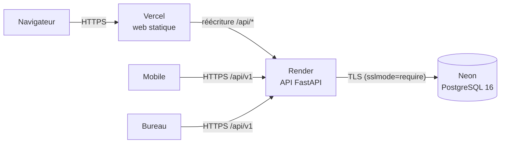

# Déploiement L1

**État au 2026-11-22 : déployé** sur des offres gratuites, sans carte bancaire. Aucun secret n'est
versionné : ils sont saisis dans les tableaux de bord des hébergeurs. Chaque étape marquée 🔐 exige une
action du responsable du projet dans l'interface de l'hébergeur.

| | URL publique |
|---|---|
| Web | <https://quincaillerie-laurentienne-seven.vercel.app> |
| API | <https://quincaillerie-laurentienne-api.onrender.com> (`/health`, `/docs`, `/api/v1/...`) |

Attention : `quincaillerie-laurentienne.vercel.app` (sans suffixe) **n'est pas** ce projet ; c'est une
autre application hébergée sous un nom semblable. Ne jamais l'utiliser dans `CORS_ORIGINS` ni
`WEB_BASE_URL`.

Hébergement retenu :

| Composant | Hébergeur | Rôle |
|---|---|---|
| Base de données | Neon (PostgreSQL 16) | Base de production ; extensions `unaccent` (requise) et `vector` (L2) |
| API | Render (service web Python) | FastAPI ; migrations et amorçage au démarrage |
| Web | Vercel (site statique Vite) | Application web ; `/api/*` relayé vers l'API (même origine) |
| Mobile, bureau | — | Configurés pour l'URL publique de l'API (aucun hébergement) |

## 1. Base de données (Neon) 🔐

1. Créer un projet PostgreSQL **16** dans la région la plus proche (Canada si offerte).
2. Vérifier les extensions **avant** la première migration :
   `SELECT name, default_version FROM pg_available_extensions WHERE name IN ('unaccent', 'vector');`
   La migration `c4a1e7d2b9f0` exécute `CREATE EXTENSION IF NOT EXISTS unaccent` : le rôle utilisé doit
   en avoir le droit. **À vérifier sur Neon** (non vérifié à ce jour).
3. Récupérer la chaîne de connexion et la convertir au pilote de l'API :
   `postgresql+psycopg://<utilisateur>:<mot-de-passe>@<hôte>/<base>?sslmode=require`.
   Elle est **secrète** : elle va uniquement dans la variable `DATABASE_URL` de Render.

## 2. API (Render) 🔐

Le fichier [`render.yaml`](../../render.yaml) décrit le service (Blueprint Render) :

- `rootDir: api`, build `pip install -r requirements.txt`, Python 3.11.
- Démarrage : `alembic upgrade head` → `python -m app.seed.seed_l1 --allow-production` →
  `uvicorn` **sans** `--proxy-headers` (aucun en-tête de proxy envoyé par le client n'est cru). L'amorçage est **idempotent** : il ne crée rien s'il a déjà été appliqué.
- Contrôle de santé : `/health`.
- `autoDeploy: true` sur `main` : **chaque fusion sur `main` redéploie l'API** (déploiement automatique).

Variables à renseigner dans le tableau de bord Render (jamais dans Git) :

| Variable | Valeur | Secrète |
|---|---|---|
| `APP_ENV` | `production` (déjà dans `render.yaml`) | Non |
| `DATABASE_URL` | Chaîne Neon convertie (étape 1) | **Oui** |
| `SECRET_KEY` | Générée par Render (`generateValue`) | **Oui** |
| `MFA_ENCRYPTION_KEY` | `python -c "from cryptography.fernet import Fernet; print(Fernet.generate_key().decode())"` | **Oui** |
| `CORS_ORIGINS` | URL du site Vercel : `https://quincaillerie-laurentienne-seven.vercel.app` | Non |
| `WEB_BASE_URL` | Même URL que `CORS_ORIGINS` (liens des courriels) | Non |
| `REFRESH_COOKIE_SAMESITE` | `strict` (le web appelle l'API par la réécriture Vercel, donc même origine) | Non |
| `CLIENT_IP_HEADER` | `cf-connecting-ip` (déjà dans `render.yaml`) — **à vérifier** : un `CF-Connecting-IP` inventé, envoyé directement à l'URL Render, ne doit pas contourner la limitation ; sinon, vider la variable | Non |
| `EMAIL_BACKEND` | `disabled` (déjà dans `render.yaml`) ; `brevo` une fois le fournisseur configuré | Non |
| `EMAIL_FROM_ADDRESS` | Adresse d'expéditeur vérifiée chez Brevo | Non |
| `BREVO_API_KEY` | Clé d'API transactionnelle Brevo | **Oui** |

Vérifications après le premier déploiement : `GET /health` → `{"status":"ok"}` ; en-tête
`Strict-Transport-Security` présent ; `GET /api/v1/products?size=1` → `total` ≥ 150 ;
`GET /api/v1/search?q=equerre` → résultats.

## 3. Web (Vercel) 🔐

[`web/vercel.json`](../../web/vercel.json) : build Vite (`dist/`), repli SPA vers `index.html`, en-têtes
de sécurité (CSP stricte, `nosniff`, `frame-ancestors 'none'`) et réécriture `/api/*` vers l'API.

La réécriture vise l'API publique **`https://quincaillerie-laurentienne-api.onrender.com`** :
`/api/:path*` → `https://quincaillerie-laurentienne-api.onrender.com/api/:path*`. Le navigateur reste sur
le domaine Vercel (même origine) : pas de CORS ni de cookie tiers pour le web.

Réglages Vercel : répertoire racine `web`, commande d'installation `npm ci`, aucune variable requise
(`VITE_API_BASE_URL` vaut `/api/v1` par défaut). Déploiement automatique à chaque fusion sur `main`.

> L'offre Hobby de Vercel refuse les déploiements de commits dont l'auteur n'est pas le propriétaire du
> compte : les fusions par squash faites par `MIKE08-CODE` sont conformes ; à vérifier si d'autres
> membres fusionnent.

## 4. Mobile et bureau

| Client | Où mettre l'URL publique de l'API |
|---|---|
| Mobile | `mobile/.env.production` : `EXPO_PUBLIC_API_BASE_URL=https://quincaillerie-laurentienne-api.onrender.com/api/v1` (non versionné) |
| Bureau | `appsettings.json` à côté de l'exécutable, ou variable `QL_API_BASE_URL=https://quincaillerie-laurentienne-api.onrender.com/api/v1` |

Chacun a un test d'intégration facultatif à lancer contre l'API déployée (voir leurs README) : c'est la
preuve attendue pour l'artéfact 6 (« clients connectés à l'API en ligne »).

## 4 bis. Activer les courriels (Brevo) 🔐

Nécessaire pour A-AUTH-01 (vérification du courriel) et A-AUTH-04 (réinitialisation). Le SMTP sortant
étant bloqué sur l'offre gratuite de Render, l'API utilise l'**API HTTPS** de Brevo. Offre gratuite :
300 envois par jour, sans carte bancaire (à revérifier sur brevo.com au moment de l'inscription) ; les
messages portent la mention « Sent with Brevo ».

**À faire par le responsable (aucune de ces étapes ne peut être faite par l'outillage) :**

1. Créer un compte gratuit sur brevo.com, **sans** saisir de carte bancaire.
2. Dans la gestion des expéditeurs de Brevo, ajouter l'adresse d'expédition et la **confirmer** par le
   lien reçu. Une adresse de messagerie gratuite (p. ex. Gmail) peut être refusée ou classée en
   indésirables par certains destinataires (DMARC) ; un domaine authentifié est plus fiable mais n'est
   **pas** nécessaire pour la démonstration.
3. Créer une **clé d'API** (section des clés SMTP et API). La copier une seule fois ; ne jamais la
   coller dans Git, une issue, une PR ou une conversation.
4. Dans Render → service `quincaillerie-laurentienne-api` → *Environment* :

   | Variable | Valeur |
   |---|---|
   | `EMAIL_BACKEND` | `brevo` |
   | `EMAIL_FROM_ADDRESS` | l'adresse confirmée à l'étape 2 |
   | `EMAIL_FROM_NAME` | `Quincaillerie Laurentienne` (facultatif) |
   | `BREVO_API_KEY` | la clé de l'étape 3 (**secret**) |
   | `WEB_BASE_URL` | `https://quincaillerie-laurentienne-seven.vercel.app` (base des liens envoyés) |

   Enregistrer : Render redéploie. Si `BREVO_API_KEY` ou `EMAIL_FROM_ADDRESS` manque, **l'API refuse de
   démarrer** (validation de la configuration) : corriger la variable, rien n'est envoyé entre-temps.
5. **Test réel** (après la fusion de la PR #50, qui crée les pages du site) :
   - s'inscrire sur `/inscription` avec une adresse **vous appartenant** ;
   - recevoir le courriel et ouvrir le lien → page « Votre adresse est vérifiée » ;
   - `/mot-de-passe-oublie` → courriel reçu → nouveau mot de passe → connexion réussie ;
   - vérifier dans Render → *Logs* qu'aucun lien, jeton ni adresse n'apparaît (seulement
     au plus un message « Échec de l'envoi du courriel « verify » … » en cas d'erreur, et rien en cas
     de succès).

   Conserver les captures (preuve P6 de la matrice de traçabilité). **Tant que ce test n'est pas
   concluant, les courriels ne sont pas déclarés opérationnels.**

## 5. Redéployer, revenir en arrière

- **Redéployer** : fusionner une PR sur `main` (déploiement automatique), ou « Manual Deploy » dans
  Render et « Redeploy » dans Vercel.
- **Revenir en arrière** : « Rollback » vers le déploiement précédent dans Render ou Vercel. Une
  migration déjà appliquée n'est pas annulée automatiquement : `alembic downgrade <révision>` est une
  opération manuelle, à faire seulement après une sauvegarde de la base (branche ou restauration Neon).

## 6. Blocages et risques connus (à décider avant la démonstration)

| # | Sujet | Effet | Décision attendue |
|---|---|---|---|
| D1 | **Fournisseur de courriel** | Corrigé côté code (F1) : un échec d'envoi n'interrompt plus la connexion et rien de secret n'est journalisé. **Sans fournisseur (`EMAIL_BACKEND=disabled`), aucun courriel de vérification ni de réinitialisation n'est remis** : A-AUTH-01 et A-AUTH-04 ne sont pas pleinement opérationnels en ligne. Le SMTP sortant est bloqué sur l'offre gratuite de Render : il faut une API HTTPS (Brevo prise en charge) | Créer un compte Brevo gratuit, vérifier un expéditeur, saisir la clé dans Render |
| D2 | **Adresse IP du client** | Corrigé côté code (F2) : `X-Forwarded-For` n'est plus cru (il était falsifiable) ; seule une adresse IP valide dans `CLIENT_IP_HEADER` est retenue. Limite assumée : derrière Vercel, les visiteurs du web partagent l'adresse de sortie de Vercel | **Vérifié en production le 2026-11-21** : un `CF-Connecting-IP` inventé est rejeté par Cloudflare (403, code 1000) ; 140 requêtes parallèles → 120 acceptées et 20 refusées (429), identique avec `X-Forwarded-For` et `X-Real-IP` inventés |
| D3 | Extensions sur Neon | Migration impossible si `unaccent` ne peut pas être créée | Vérifier à l'étape 1 |
| D4 | Mise en veille (offres gratuites) | Première requête lente après inactivité (Render) | Réveiller l'API avant la démonstration |
| D5 | Amorçage en production | Données fictives de démonstration en production (voulu pour la L1) | Confirmer |
| D6 | Stockage des images | Téléversement validé (PR #49) mais **sans stockage persistant** : 503 `image_storage_not_configured` ; le disque de Render est éphémère | Accord sur Cloudinary gratuit (ADR-009), puis saisie des secrets dans Render |
| D7 | Contrôles CI obligatoires | Seuls `api-ci` et `security` sont exigés par le ruleset ; `web-ci`, `mobile-ci`, `desktop-ci` ne le sont pas | Décider de les ajouter au ruleset `protect-main` |

## 7. Preuves de déploiement (artéfacts 3, 6 et 7)

Vérifications faites le 2026-11-21 et le 2026-11-22, **uniquement par des lectures (GET, OPTIONS)** :
aucune donnée n'a été modifiée.

| Preuve | Résultat |
|---|---|
| Déploiements Render déclenchés par `main` | `07fc02c` : succès ([déploiement 7970866629](https://github.com/MIKE08-CODE/Quincaillerie-Laurentienne-Projet-A/deployments)) ; `367b26f` : succès (précédé d'une tentative en échec, suivie d'un déploiement réussi) |
| Déploiement Vercel de `main` | Statut GitHub « Vercel – quincaillerie-laurentienne : success » sur `07fc02c` ; fichiers servis identiques au build de `main` (`index-D1LCzNrd.js`, `index-8qHuH_q7.css`) |
| API `/health` | 200, `{"status":"ok"}`, en-tête HSTS |
| Données d'amorçage en production | 3 magasins, 7 catégories racines, **157 produits** |
| Recherche plein texte (prouve la migration `unaccent`/`search_vector`) | `perceuse` : 13, `drill` : 14, `equerre` et `équerre` : 5 chacun |
| Règles de l'API | `size=51` → 422 ; produit inconnu → 404 `product_not_found` ; `/admin` sans jeton → 401 ; aucune quantité exposée |
| Web : en-têtes de `vercel.json` | CSP stricte, `nosniff`, `Referrer-Policy`, `Permissions-Policy`, HSTS |
| Web : relais `/api` vers Render | Mêmes résultats que l'API directe (157 produits, recherche, fiche `PERC-18V`, 422, 401) |
| CORS | Requête préalable depuis l'origine du site : 200 |
| Bureau → API publique | Test d'intégration `Category=Integration` : **1 réussi** |
| Mobile → API publique | Test d'intégration : **1 réussi** avec la correction HTTPS de la PR #37 (non fusionnée au moment du relevé) |

Preuves encore manquantes :
- journal de démarrage Render montrant `alembic upgrade head` jusqu'à `e2c9a4b7d3f1` et le rapport
  d'amorçage (à copier depuis le tableau de bord Render, sans secret) ;
- captures d'écran du site dans un navigateur et de `/docs` ;
- démonstration du mobile sur un appareil ou un émulateur ;
- courriels de vérification et de réinitialisation (fournisseur non configuré, voir D1).
