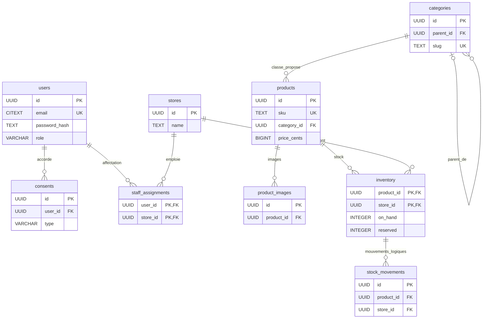
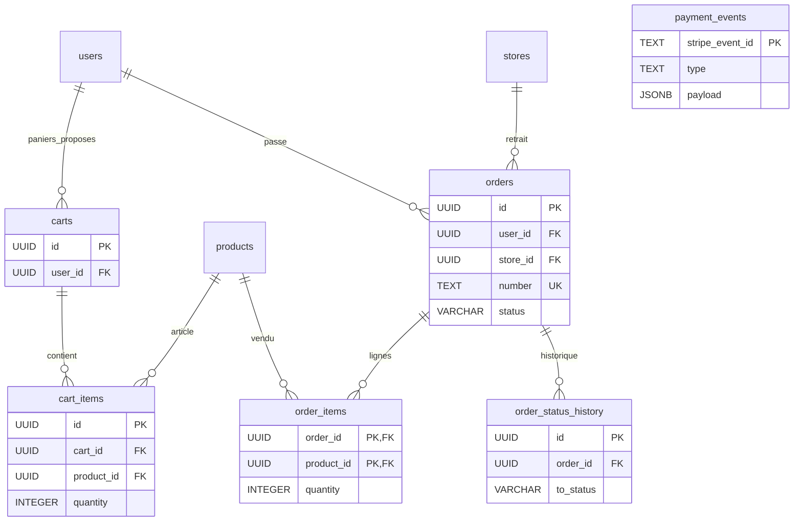
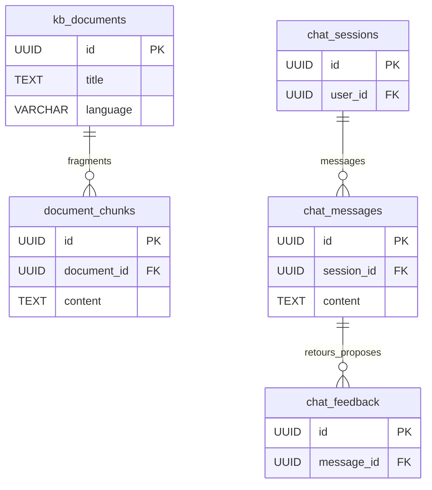

# Modèle de données — Quincaillerie Laurentienne (Projet A)
**Livrable L1 — Fondations | Version documentaire 1.2 | 21 novembre 2026**  
**Équipe :** à compléter · **Responsable :** à compléter · **Dépôt GitHub :** à compléter  
**Statut :** modèle cible proposé ; vérification du code, des migrations et de la base déployée en attente.

> **Principe de conservation :** les entités, champs, types, choix de modélisation et séquence de migrations de la version 1.0 sont maintenus. Les clarifications ci-dessous ne constituent pas des changements de schéma approuvés. Toute contrainte ou table additionnelle est explicitement une proposition à valider.

## 1. Objet, périmètre et sources
Ce document décrit le modèle relationnel cible du Projet A. La L1 demande un modèle entité-relation couvrant les entités **Must**, un dictionnaire de données et des migrations Alembic appliquées dans l’environnement cible. Références : cahier des charges, A.4, A.5, A.6, A.11 et §9.1. Les clés techniques et choix non explicitement imposés restent proposés.

**Jalons :** L1 couvre notamment comptes, catalogue, gestion de produits, magasins et stocks d’amorçage ; commandes, cueillette et RAG sont documentés comme **modèle cible** pour les jalons ultérieurs. Une entité décrite n’est pas nécessairement implémentée.

## 2. Principes de modélisation
- PostgreSQL 16 avec pgvector ; identifiants UUID lorsque pertinents ; clés étrangères explicites ; horodatages `TIMESTAMPTZ` en UTC.
- Prix en cents entiers (`BIGINT`), jamais en flottant ; champs français et anglais pour produits et catégories.
- Stock disponible = `on_hand - reserved` ; invariant `0 <= reserved <= on_hand` ; opérations de réservation et changement de statut transactionnelles.
- Seule l’API FastAPI accède à PostgreSQL ; les trois clients ne s’y connectent pas directement.
- Index ciblés : courriels sans distinction de casse, SKU, recherche plein texte, commandes et mouvements de stock.

## 3. Modèle entité-relation — Mermaid
Les schémas sont **logiques et cibles**. Les relations signalées « proposées » dans la version 1.0 restent soumises à validation. Les attributs sont détaillés dans le dictionnaire ci-dessous.

### 3.1 Comptes, magasins et catalogue

**Notes :** `products.category_id` et la relation logique `inventory` → `stock_movements` proviennent des propositions du document source ; la clé étrangère composite correspondante n’est **pas** affirmée comme implémentée.

### 3.2 Paniers, commandes et paiements

**Note :** `payment_events` n’a pas de clé étrangère explicite vers `orders` dans le modèle initial : aucun lien n’est inventé dans le diagramme. La corrélation métier via les identifiants Stripe reste à spécifier et valider.

### 3.3 Connaissances, clavardage et administration

**Autres entités du dictionnaire :** `promotions`, `promo_codes`, `reviews`, `audit_logs` ; leurs relations non explicitement établies dans la version 1.0 ne sont pas inventées.

### 3.4 Cardinalités documentées dans la version 1.0
| Source | Cible | Cardinalité | Signification |
|---|---|---|---|
| users | consents | 1:N | un utilisateur possède plusieurs consentements |
| users | staff_assignments | 1:N | affectations de personnel |
| stores | staff_assignments | 1:N | employés affectés |
| categories | categories | 1:N | catégorie parent / sous-catégories |
| categories | products | 1:N proposé | catégorie principale de produit (FK à ajouter) |
| products | product_images | 1:N | images d’un produit |
| products | inventory | 1:N | stock par magasin |
| stores | inventory | 1:N | stocks du magasin |
| inventory | stock_movements | 1:N logique | mouvements identifiés par produit + magasin |
| users | carts | 1:N proposé | paniers; politique de panier actif à définir |
| carts | cart_items | 1:N | lignes de panier |
| products | cart_items | 1:N | articles en panier |
| users | orders | 1:N | commandes du client |
| stores | orders | 1:N | commandes à retirer dans un magasin |
| orders | order_items | 1:N | lignes de commande |
| orders | order_status_history | 1:N | historique des transitions |
| products | order_items | 1:N | produits vendus |
| kb_documents | document_chunks | 1:N | fragments documentaires |
| chat_sessions | chat_messages | 1:N | messages de session |

## 4. Dictionnaire de données — modèle cible
Les types et attributs ci-dessous sont **repris de la version 1.0**. Les mentions « proposé » conservent leur statut ; `NULL` ou `NOT NULL` ne sont pas inférés lorsqu’ils ne sont pas spécifiés.

| Entité | Attributs et types documentés | Contraintes / justification |
|---|---|---|
| users | id UUID PK; email CITEXT UNIQUE; password_hash TEXT; role VARCHAR; first_name TEXT; last_name TEXT; language VARCHAR(2); email_verified_at TIMESTAMPTZ NULL; mfa_secret BYTEA NULL; is_active BOOLEAN; created_at TIMESTAMPTZ | role contrôlé; email unique insensible à la casse; secret MFA chiffré |
| consents | id UUID PK; user_id UUID FK; type VARCHAR; version VARCHAR; granted_at TIMESTAMPTZ; revoked_at TIMESTAMPTZ NULL | conserver l’historique du consentement |
| stores | id UUID PK; name TEXT; address TEXT; phone TEXT; opening_hours JSONB | 3 magasins initiaux |
| staff_assignments | user_id UUID FK; store_id UUID FK; PK(user_id,store_id) | affectation commis/gérant à un magasin |
| categories | id UUID PK; parent_id UUID FK NULL; name_fr TEXT; name_en TEXT; slug TEXT UNIQUE | arbre sans cycle; parent auto-référencé |
| products | id UUID PK; sku TEXT UNIQUE; name_fr TEXT; name_en TEXT; description_fr TEXT; description_en TEXT; brand TEXT; price_cents BIGINT; specs JSONB; is_active BOOLEAN; search_vector TSVECTOR | prix >=0; index GIN recherche; category_id FK proposé |
| product_images | id UUID PK; product_id UUID FK; url TEXT; alt_fr TEXT; alt_en TEXT; position INTEGER | ordre des images |
| inventory | product_id UUID FK; store_id UUID FK; on_hand INTEGER; reserved INTEGER; reorder_threshold INTEGER; version INTEGER; PK(product_id,store_id) | CHECK on_hand >= 0, reserved >= 0, reserved <= on_hand |
| stock_movements | id UUID PK; product_id UUID FK; store_id UUID FK; type VARCHAR; quantity INTEGER; reason TEXT; actor_id UUID FK NULL; order_id UUID FK NULL; created_at TIMESTAMPTZ | journal append-only; types vente, réservation, libération, réception, ajustement, retour, transfert |
| carts | id UUID PK; user_id UUID FK; created_at TIMESTAMPTZ (proposé) | panier persistant pour utilisateur authentifié |
| cart_items | id UUID PK (proposé); cart_id UUID FK; product_id UUID FK; quantity INTEGER | CHECK quantity BETWEEN 1 AND 20; UNIQUE(cart_id,product_id) |
| orders | id UUID PK; number TEXT UNIQUE; user_id UUID FK; store_id UUID FK; status VARCHAR; subtotal_cents BIGINT; discount_cents BIGINT; gst_cents BIGINT; qst_cents BIGINT; total_cents BIGINT; stripe_payment_intent_id TEXT; pickup_token_hash TEXT; created_at TIMESTAMPTZ | statuts contrôlés; une commande = un magasin |
| order_items | order_id UUID FK; product_id UUID FK; quantity INTEGER; unit_price_cents BIGINT; product_name_snapshot TEXT; PK(order_id,product_id) proposé | instantané du nom et du prix au moment de la commande |
| order_status_history | id UUID PK proposé; order_id UUID FK; from_status VARCHAR; to_status VARCHAR; actor_id UUID FK NULL; created_at TIMESTAMPTZ | traces des transitions autorisées |
| payment_events | stripe_event_id TEXT PK; type TEXT; payload JSONB; processed_at TIMESTAMPTZ | idempotence des webhooks Stripe |
| promotions | id UUID PK proposé; type VARCHAR; value NUMERIC; scope VARCHAR; starts_at TIMESTAMPTZ; ends_at TIMESTAMPTZ | Could; règles de promotion |
| promo_codes | id UUID PK proposé; code TEXT UNIQUE; max_uses INTEGER; used_count INTEGER | Could; limite d’utilisation atomique |
| reviews | id UUID PK; product_id UUID FK; user_id UUID FK; rating INTEGER; comment TEXT; status VARCHAR | Could; avis réservés aux acheteurs et modérés |
| audit_logs | id UUID PK; actor_id UUID FK; action TEXT; entity TEXT; entity_id TEXT; before JSONB; after JSONB; ip TEXT; created_at TIMESTAMPTZ | audit des opérations sensibles |
| kb_documents | id UUID PK; title TEXT; language VARCHAR; source TEXT; version TEXT; hash TEXT | documents de connaissance sans données personnelles |
| document_chunks | id UUID PK; document_id UUID FK; content TEXT; embedding VECTOR(n); metadata JSONB | dimension n selon fournisseur; index HNSW |
| chat_sessions | id UUID PK proposé; user_id UUID FK NULL; created_at TIMESTAMPTZ proposé | session de clavardage; conservation limitée |
| chat_messages | id UUID PK proposé; session_id UUID FK; role TEXT; content TEXT; sources JSONB | masquer les renseignements personnels |
| chat_feedback | id UUID PK proposé; message_id UUID FK proposé; rating VARCHAR | rétroaction utile/pas utile |

### 4.1 Contraintes essentielles à vérifier dans le schéma
| Domaine | Règle du modèle | Statut documentaire |
|---|---|---|
| Comptes | `users.email` unique sans distinction de casse (`CITEXT`) ; `users.role` contrôlé | Cible ; preuve SQL à fournir |
| Catalogue | `products.sku` unique ; `price_cents >= 0` ; catégories sans cycle | Cible ; mécanisme anti-cycle à préciser |
| Stocks | `inventory` PK `(product_id, store_id)` ; `on_hand >= 0`, `reserved >= 0`, `reserved <= on_hand` | Cible ; tests DB requis |
| Panier | `cart_items.quantity BETWEEN 1 AND 20` ; `UNIQUE(cart_id, product_id)` | Cible ; tests DB requis |
| Commandes | Statuts contrôlés, prix instantanés et historisation des transitions | Cible ; vérifier contrôle applicatif et SQL |
| Paiements | `payment_events.stripe_event_id` unique et traitement idempotent | Cible ; tests de rejeu requis |
| Vie privée | Consentements horodatés ; données MFA protégées ; minimisation des données du RAG | Cible ; revue de sécurité requise |

### 4.2 Décisions de conception ouvertes (sans changement du modèle)
- **DEC-DATA-01 — Réservations :** le modèle actuel conserve `inventory.reserved` sans table dédiée. Documenter l’association réservation/commande, la date d’expiration à 15 minutes, les libérations et la reprise après incident. Une éventuelle table `stock_reservations` est une **option à valider**, pas un ajout adopté.
- **DEC-DATA-02 — Mouvements :** préciser le signe et la sémantique de chaque type de mouvement, ainsi que la réconciliation entre quantités courantes et journal. Une FK composite de `stock_movements(product_id, store_id)` vers `inventory` est **proposée**, non actée.
- **DEC-DATA-03 — Paiements :** définir la corrélation fiable entre `payment_events` et `orders` sans supposer l’existence d’une FK.
- **DEC-DATA-04 — Personnel :** préciser la règle sur les affectations simultanées et leur historique.
- **DEC-DATA-05 — Recherche :** préciser le maintien de `search_vector` pour les textes FR/EN et le traitement `unaccent`.
- **DEC-DATA-06 — Vecteurs :** fixer `VECTOR(n)` et les paramètres d’index HNSW une fois le modèle d’embeddings choisi.

## 5. Transactions et intégrité
- **A-ORD-04 :** réservation atomique sous verrouillage `SELECT … FOR UPDATE` ou contrôle optimiste par version ; expiration après 15 minutes. La décision exacte relève de l’ADR-001.
- **A-ORD-05/06 :** validation de la signature du webhook Stripe, unicité de `stripe_event_id` et idempotence du traitement.
- **A-ORD-07 :** transitions `pending_payment → paid → preparing → ready_for_pickup → picked_up`, avec `cancelled`, `refunded`, `expired` selon les règles autorisées.
- **A-PCK-01/03 :** conserver uniquement l’empreinte du jeton de cueillette et refuser sa seconde utilisation.
- **A-INV-01 :** journal des mouvements en ajout seulement et contrôle de réconciliation avec `inventory`.
- **Invariant transactionnel :** une réservation, sa libération, son mouvement et le changement de commande correspondant doivent rester cohérents en cas d’échec.

## 6. Index, migrations et données initiales
### 6.1 Plan cible de migrations de la version 1.0
| Migration proposée | Contenu | Preuve attendue |
|---|---|---|
| 0001_core | users, consents, stores, staff_assignments, categories, products, product_images | revision Alembic + capture schéma |
| 0002_inventory | inventory, stock_movements et contraintes | tests contraintes + migration |
| 0003_catalog_orders | carts, cart_items, orders, order_items, order_status_history, payment_events | migration + tests transactionnels |
| 0004_admin_rag | audit_logs, promotions, reviews, kb_documents, document_chunks, chat_* | migration selon périmètre / jalon |
| seed_l1 | 3 magasins, au moins 150 produits, inventaires | script reproductible + captures API |

**Attention :** ces identifiants sont des noms *proposés*, non des révisions Alembic constatées. Les migrations réelles doivent être relevées dans `api/alembic/versions/` et comparées à l’état `alembic_version` de la base cible, sans renommer les révisions existantes. Selon un rapport antérieur de Claude Code, une migration d’authentification `aa6b82a168aa` existe dans une base de test ; cela ne prouve pas son déploiement en production.

### 6.2 Stratégie de vérification des migrations
- Inventorier les révisions existantes et leur graphe de dépendances.
- Vérifier que la migration d’une base vide vers `head` est reproductible dans une base de test isolée.
- Contrôler les contraintes et index effectivement créés ; comparer avec les modèles SQLAlchemy.
- Exécuter `alembic check` lorsque l’environnement de test le permet ; conserver les résultats.
- Ne déclarer les migrations « appliquées en production » qu’après preuve de l’environnement réellement déployé.
- Prévoir une procédure de sauvegarde/restauration avant toute migration sur un environnement partagé.

### 6.3 Données d’amorçage L1
Le script `seed_l1` cible **3 magasins, au moins 150 produits et leurs inventaires par magasin**. Le script doit être reproductible, éviter les doublons lors de relances et produire des preuves vérifiables (comptages SQL et réponses API). La réalisation effective reste **à vérifier**.

## 7. Vérifications et critères d’acceptation L1
- [ ] Diagrammes ER Mermaid lisibles, entités Must couvertes, PK/FK et cardinalités documentées.
- [ ] Dictionnaire cohérent avec les modèles SQLAlchemy et le schéma PostgreSQL réellement déployé.
- [ ] Migrations Alembic applicables sur une base vide et preuve de leur application dans l’environnement cible.
- [ ] Trois magasins, au moins 150 produits et stocks associés après amorçage.
- [ ] Tests de contraintes : unicité email/SKU, stock non négatif, `reserved <= on_hand`, quantité panier 1–20.
- [ ] Traçabilité : chemins des modèles, fichiers Alembic, tests, captures de résultats et URL de déploiement à renseigner.

### 7.1 Matrice de traçabilité
| Entités / domaine | Exigences associées | Jalon dominant | Preuve |
|---|---|---|---|
| `users`, `consents`, `staff_assignments` | A-AUTH-01 à 05, A-AUTH-07 | L1 | Modèles, migrations, tests |
| `stores`, `categories`, `products`, `product_images` | A-CAT-01 à 03, A-ADM-01 | L1 | API, tests, seed |
| `inventory`, `stock_movements` | A-CAT-02, A-INV-01/02/05 | L1 (stock d’amorçage), L2 (opérations) | Contraintes, mouvements, tests |
| `carts`, `cart_items`, `orders`, `order_items`, `payment_events` | A-ORD-01 à 07 | L2 | Tests transactionnels |
| `order_status_history` | A-ORD-07 | L2 | Tests de transitions |
| `kb_documents`, `document_chunks`, `chat_*` | Agent RAG | L2/L3 | Tests de récupération et évaluation |
| `audit_logs`, `promotions`, `reviews` | A-ADM, A-ORD-10, A-CAT-05 selon portée | L2/L3 / optionnel | Tests ciblés |

### 7.2 Registre de vérification différée
| ID | Élément | Statut | Preuve / validation attendue |
|---|---|---|---|
| VER-01 | Modèles SQLAlchemy | À vérifier | Chemins et définitions des classes |
| VER-02 | Révisions Alembic | À vérifier | Identifiants réels et graphe |
| VER-03 | Schéma PostgreSQL déployé | À vérifier | Inventaire SQL, contraintes, index |
| VER-04 | Seed L1 | À vérifier | Comptages 3 magasins / ≥150 produits / stocks |
| DEC-01 | Réservations et expiration | À valider | Mécanisme métier et ADR-001 |
| DEC-02 | Relations complémentaires | À valider | FK composites, lien paiements-commandes |
| DEC-03 | Dimension vectorielle | À valider | Fournisseur/modèle d’embeddings |

**Liens à renseigner :** dépôt GitHub [à compléter] · migrations [à compléter] · diagramme [présent dans ce document] · preuve de déploiement [à compléter].

## 8. Schéma implémenté et vérifié (L1)

Cette section décrit le schéma **réellement créé** par les migrations Alembic (vérifié le 21 novembre
2026 dans une base PostgreSQL 16 + pgvector isolée). Les tables du catalogue, des stocks et des entités
transactionnelles sont dans la **PR #29, non fusionnée** ; elles ne sont **pas encore appliquées en
production** (aucun déploiement). Preuve « migrations appliquées en production » : à compléter.

### 8.1 Révisions Alembic

| Révision | Parent | Contenu | État |
|---|---|---|---|
| `7217efbff6be` | — | `users`, `consents`, `stores`, `staff_assignments`, `one_time_tokens`, `refresh_tokens` | Fusionné sur `main` |
| `aa6b82a168aa` | `7217efbff6be` | Expiration absolue des sessions, invalidation des jetons | Fusionné sur `main` |
| `c4a1e7d2b9f0` | `aa6b82a168aa` | `unaccent`, configurations `fr_unaccent`/`en_unaccent`, `categories` (+ déclencheur anti-cycle), `brands`, `products` (+ `search_vector`, GIN), `product_images` | PR #29 |
| `d8b3f5a6c1e2` | `c4a1e7d2b9f0` | `inventory`, `stock_movements` (+ déclencheur « ajout seulement ») | PR #29 |
| `e2c9a4b7d3f1` (head) | `d8b3f5a6c1e2` | `carts`, `cart_items`, `orders`, `order_items`, `order_status_history`, `payment_events`, FK `stock_movements.order_id` | PR #29 |

Vérifications automatisées (PR #29) : `alembic check` sans écart entre modèles et migrations ;
aller-retour `downgrade` / `upgrade` ; suite complète appliquant toutes les migrations sur une base vide.

### 8.2 Entités Must créées et écarts avec le modèle cible

| Entité | État | Écart ou précision par rapport au §4 |
|---|---|---|
| `users` | Créée | Unicité du courriel par **index unique sur `lower(email)`** (et non `CITEXT`) ; colonnes MFA et verrouillage ajoutées |
| `consents`, `stores`, `staff_assignments` | Créées | `stores.phone` obligatoire (30 caractères) |
| `one_time_tokens`, `refresh_tokens` | Créées | Entités techniques hors A.6 (A-AUTH-01, 02, 04) |
| `categories` | Créée (PR #29) | Déclencheur `categories_prevent_cycle` (refus des cycles) ; CHECK du format du `slug` |
| **`brands`** | Créée (PR #29) | **Entité ajoutée** (ADR-004) : `products.brand_id` remplace l'attribut texte `brand` de A.6 |
| `products` | Créée (PR #29) | `category_id` et `brand_id` (RESTRICT) ; `updated_at` ; `search_vector` **généré** (ADR-006) |
| `product_images` | Créée (PR #29) | URL `https://` obligatoire ; position unique par produit |
| `inventory` | Créée (PR #29) | CHECK de A.6 + `reorder_threshold >= 0`, `version >= 1` |
| `stock_movements` | Créée (PR #29) | Quantité **signée** contrôlée par type ; motif obligatoire pour `adjustment` ; FK composée vers `inventory` ; ajout seulement (ADR-005) |
| `carts`, `cart_items` | Créées (PR #29) | Un panier par client (UNIQUE `user_id`) avec `store_id` ; quantité 1 à 20 |
| `orders`, `order_items`, `order_status_history` | Créées (PR #29) | Statuts d'A-ORD-07 (CHECK) ; `total = sous-total − remise + TPS + TVQ` (CHECK) |
| `payment_events` | Créée (PR #29) | `stripe_event_id` en clé primaire |
| `promotions`, `promo_codes`, `audit_logs`, tables du RAG, `reviews` | **Non créées** | Hors entités Must (orientation O8) ; à créer à leur jalon |

DEC-DATA-02 (mouvements) et DEC-DATA-05 (recherche) sont tranchées par les ADR-005 et ADR-006.

### 8.3 Données d'amorçage L1 (`python -m app.seed.seed_l1`, PR #29)

Mesuré dans la base isolée après **deux** exécutions : 3 magasins, 30 catégories, 8 marques fictives,
157 produits bilingues, 157 images, 471 lignes de stock (56 ruptures, 71 stocks faibles, 344 en stock),
415 mouvements `receipt`, 0 doublon, 0 écart entre le stock et le grand livre. VER-04 : vérifié
localement ; preuve en production à compléter.

---
**Historique :** v1.0 (19 novembre 2026), modèle initial ; v1.1 (21 novembre 2026), ajout de diagrammes Mermaid, clarification des contraintes, de la traçabilité et des validations en attente, sans modification de la base conceptuelle ; v1.2 (21 novembre 2026), schéma implémenté et vérifié (§8), entité `brands`, écarts consignés.
