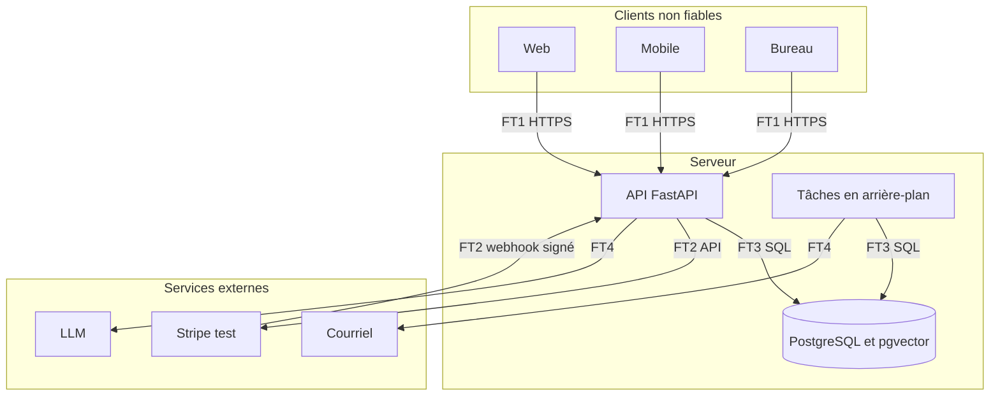
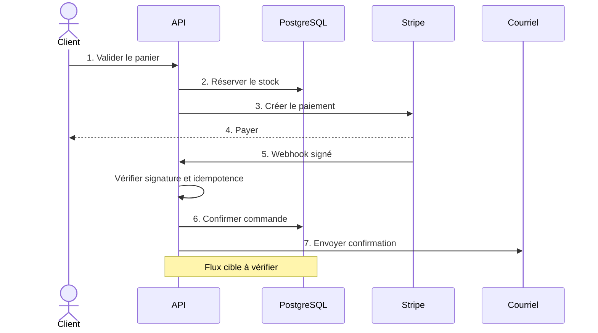
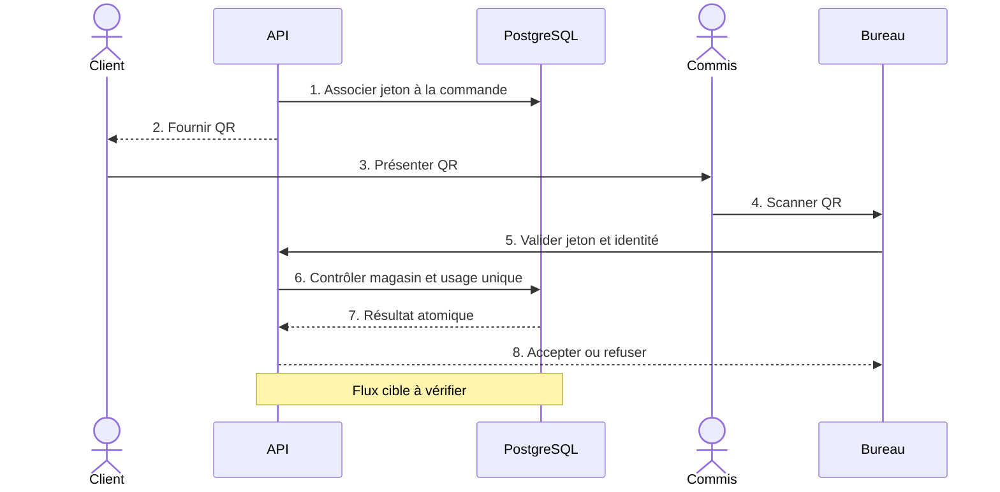

# Modèle de menaces — Quincaillerie Laurentienne (Projet A)

|  |  |
| :---- | :---- |
| **Livrable** | L1 — Fondations (`v0.1.0`) |
| **Version documentaire** | 1.1 |
| **Statut** | Révisé — validations en attente |
| **Auteur** | \[à compléter\] |
| **Flux analysés** | Paiement et cueillette en magasin |

**But :** identifier comment quelqu'un pourrait abuser du paiement ou de la cueillette, et relier chaque protection à une exigence du cahier des charges.

**Contenu :** 1\. Frontières de confiance · 2\. Analyse STRIDE du paiement · 3\. Analyse STRIDE de la cueillette · 4\. Mesures d'atténuation reliées aux exigences.

**STRIDE, en bref**

| Lettre | Menace | Question |
| :---- | :---- | :---- |
| **S** | Usurpation | Quelqu'un peut-il se faire passer pour un autre ? |
| **T** | Altération | Quelqu'un peut-il modifier une donnée qu'il ne devrait pas ? |
| **R** | Répudiation | Quelqu'un peut-il nier une action sans qu'on puisse le prouver ? |
| **I** | Divulgation | Quelqu'un peut-il voir ce qu'il ne devrait pas ? |
| **D** | Déni de service | Quelqu'un peut-il bloquer les autres utilisateurs ? |
| **E** | Élévation de privilèges | Quelqu'un peut-il obtenir plus de droits que prévu ? |

---

## 1. Frontières de confiance

Une frontière de confiance est la ligne entre ce que le système contrôle et ce qu'il ne contrôle pas. Tout ce qui la traverse doit être vérifié.

| Frontière | Passage | Règle |
| :---- | :---- | :---- |
| **FT1** | Clients → API | Aucune confiance dans le client : prix, rôle, propriété et état sont revalidés par le serveur |
| **FT2** | API ↔ Stripe | Un webhook n'est accepté qu'après vérification de sa signature |
| **FT3** | Serveur → base de données | Requêtes paramétrées; secrets hors du dépôt |
| **FT4** | Serveur → courriel et LLM | Aucun renseignement personnel inutile; clés d'API en variables d'environnement |

---

## 2. Flux 1 : paiement

| ID | STRIDE | Menace | Mesure d'atténuation | Exigences |
| :---- | :---- | :---- | :---- | :---- |
| P-01 | S | Un pirate se fait passer pour un client | Jetons courts, cookie httpOnly, mots de passe hachés (Argon2id), verrouillage après échecs | A-AUTH-02, A-AUTH-03, A-AUTH-07, ENF-02, ENF-05 |
| P-02 | S | Faux webhook « paiement réussi » | Signature vérifiée sur le corps brut avec le secret du webhook; sinon rejet | A-ORD-05, A-D3† |
| P-03 | T | Le client modifie le prix, le total ou la quantité | Le serveur recalcule tout; montants en cents entiers; quantité maximale de 20 | A-ORD-03, RA-A-03, RA-A-04, RA-A-07, A-D2†, A-D6† |
| P-04 | T | Survente : 50 acheteurs pour 5 unités | Verrouillage transactionnel (`FOR UPDATE`), contraintes `CHECK` et test de concurrence | A-ORD-04, A-D1† |
| P-05 | T | Webhook rejoué : commande en double | Table `payment_events` avec identifiant d’événement unique et traitement atomique | A-ORD-06, A-D3† |
| P-06 | T | Changement d'état interdit (annuler après préparation) | Machine à états : transitions invalides refusées | A-ORD-07, RA-A-05 |
| P-07 | R | Quelqu'un nie avoir annulé ou remboursé une commande | Historique des statuts (auteur, heure) et journal d'audit | A-ORD-07, A-ADM-04 |
| P-08 | I | Un client lit la commande d'un autre (IDOR) | Vérification du rôle et de la propriété sur chaque route | ENF-04, A-D4† |
| P-09 | I | Fuite de données dans les journaux ou le dépôt | Aucune donnée de carte (Stripe); journaux sans renseignements personnels; secrets en variables d'environnement | ENF-02, ENF-13 |
| P-10 | D | Réserver le stock sans payer, ou saturer l'API | Réservation expirée après 15 min; limitation de débit | A-ORD-04, RA-A-02, ENF-05 |
| P-11 | E | Un client appelle une route du personnel | Contrôle du rôle sur chaque route; MFA du personnel | A-AUTH-05, A-AUTH-06, ENF-04 |

---

## 3. Flux 2 : cueillette en magasin

| ID | STRIDE | Menace | Mesure d'atténuation | Exigences |
| :---- | :---- | :---- | :---- | :---- |
| K-01 | S | Faux code QR fabriqué ou modifié | Jeton signé (HMAC ou JWT); seul son hash est stocké | A-PCK-01, RA-A-06 |
| K-02 | S | Quelqu'un utilise le QR d'un autre (capture d'écran) | Jeton expirant et vérification complémentaire lors de la remise; une capture valide peut être réutilisée avant consommation | A-PCK-01, A-PCK-02 |
| K-03 | T | Le même QR utilisé deux fois | Jeton à usage unique; contrôle et consommation atomiques, inutilisable après `picked_up` | A-PCK-03, RA-A-06 |
| K-04 | T | Commande d'un autre magasin remise | Jeton lié au magasin; refus avec message clair | A-PCK-02, RA-A-06, A-D4† |
| K-05 | R | Le commis nie avoir remis la commande | Commis et heure enregistrés; journal d'audit | A-PCK-03, A-ADM-04 |
| K-06 | I | La saisie manuelle sert à deviner des commandes | Messages d'erreur génériques; limitation de débit | ENF-05, A-D4† |
| K-07 | D | Validations répétées pour saturer l'API | Limitation de débit sur la route de validation | ENF-05 |
| K-08 | E | Un commis valide une cueillette d'un autre magasin | Contrôle du rôle et du magasin; MFA du personnel | A-AUTH-05, A-AUTH-06, A-D4† |

---

## 4. Mesures d'atténuation reliées aux exigences

| \# | Mesure | Exigences | Menaces couvertes |
| :---- | :---- | :---- | :---- |
| 1 | Authentification sécurisée (jetons courts, cookie httpOnly, Argon2id, verrouillage) | A-AUTH-02, A-AUTH-03, A-AUTH-07, ENF-02, ENF-05 | P-01 |
| 2 | Vérification de la signature des webhooks | A-ORD-05, A-D3† | P-02 |
| 3 | Prix et taxes calculés par le serveur, montants en cents | A-ORD-03, RA-A-03, RA-A-04, RA-A-07, A-D2†, A-D6† | P-03 |
| 4 | Verrouillage du stock (`FOR UPDATE` \+ `CHECK`) | A-ORD-04, A-D1† | P-04 |
| 5 | Traitement idempotent des webhooks | A-ORD-06, A-D3† | P-05 |
| 6 | Machine à états de la commande | A-ORD-07, RA-A-05 | P-06 |
| 7 | Historique des statuts et journal d'audit | A-ORD-07, A-PCK-03, A-ADM-04 | P-07, K-05 |
| 8 | Contrôle du rôle, de la propriété et du magasin sur chaque route | A-AUTH-05, ENF-04, A-D4† | P-08, P-11, K-04, K-08 |
| 9 | Journaux sans renseignements personnels, secrets hors du dépôt, aucune donnée de carte | ENF-02, ENF-13 | P-09 |
| 10 | Réservation expirée après 15 min et limitation de débit | A-ORD-04, RA-A-02, ENF-05 | P-10, K-07 |
| 11 | MFA du personnel (mesure cible, à vérifier) | A-AUTH-06 | P-11, K-08 |
| 12 | Jeton de cueillette signé, à usage unique, expirant et lié au magasin | A-PCK-01, A-PCK-02, A-PCK-03, RA-A-06 | K-01, K-02, K-03, K-04 |
| 13 | Messages d'erreur génériques sur la saisie manuelle | ENF-05, A-D4† | K-06 |

> **Références à confirmer :** `A-D1†`, `A-D2†`, `A-D3†`, `A-D4†`, `A-D6†` sont conservées du document initial; leur correspondance exacte au cahier des charges doit être vérifiée. La MFA du personnel est une mesure cible dont la réalisation n'est pas attestée ici.

---

## 5. Cotation des risques et risques résiduels

**Méthode proposée, à valider :** probabilité 1 à 3, impact 1 à 3, score = probabilité × impact. Faible : 1–2; moyen : 3–4; élevé : 6–9. Le risque initial est coté avant les protections; le risque résiduel uniquement après vérification des contrôles. Aucun score n'est inventé.

| Menace | Probabilité | Impact | Score initial | Contrôle vérifié | Risque résiduel | Responsable |
| :-- | :-- | :-- | :-- | :-- | :-- | :-- |
| P-01 | À évaluer | À évaluer | À calculer | À vérifier | À évaluer | À désigner |
| P-02 | À évaluer | À évaluer | À calculer | À vérifier | À évaluer | À désigner |
| P-03 | À évaluer | À évaluer | À calculer | À vérifier | À évaluer | À désigner |
| P-04 | À évaluer | À évaluer | À calculer | À vérifier | À évaluer | À désigner |
| P-05 | À évaluer | À évaluer | À calculer | À vérifier | À évaluer | À désigner |
| P-06 | À évaluer | À évaluer | À calculer | À vérifier | À évaluer | À désigner |
| P-07 | À évaluer | À évaluer | À calculer | À vérifier | À évaluer | À désigner |
| P-08 | À évaluer | À évaluer | À calculer | À vérifier | À évaluer | À désigner |
| P-09 | À évaluer | À évaluer | À calculer | À vérifier | À évaluer | À désigner |
| P-10 | À évaluer | À évaluer | À calculer | À vérifier | À évaluer | À désigner |
| P-11 | À évaluer | À évaluer | À calculer | À vérifier | À évaluer | À désigner |
| K-01 | À évaluer | À évaluer | À calculer | À vérifier | À évaluer | À désigner |
| K-02 | À évaluer | À évaluer | À calculer | À vérifier | À évaluer | À désigner |
| K-03 | À évaluer | À évaluer | À calculer | À vérifier | À évaluer | À désigner |
| K-04 | À évaluer | À évaluer | À calculer | À vérifier | À évaluer | À désigner |
| K-05 | À évaluer | À évaluer | À calculer | À vérifier | À évaluer | À désigner |
| K-06 | À évaluer | À évaluer | À calculer | À vérifier | À évaluer | À désigner |
| K-07 | À évaluer | À évaluer | À calculer | À vérifier | À évaluer | À désigner |
| K-08 | À évaluer | À évaluer | À calculer | À vérifier | À évaluer | À désigner |

## 6. Plan de vérification

| Menaces | Test ou preuve attendue | État |
| :-- | :-- | :-- |
| P-01, P-11 | Tests authentification, RBAC, MFA selon périmètre | À vérifier |
| P-02 | Webhook falsifié, signature incorrecte, corps modifié | À vérifier |
| P-03 | Prix et quantité modifiés côté client, recalcul serveur | À vérifier |
| P-04 | 50 achats simultanés pour 5 unités, aucune survente | À vérifier |
| P-05 | Webhook rejoué et reçu en parallèle, un seul effet métier | À vérifier |
| P-06, P-07 | Transitions interdites refusées et audit attribuable | À vérifier |
| P-08, K-04, K-08 | Accès IDOR et validation hors magasin refusés | À vérifier |
| P-09 | Contrôle de secrets et journaux sans données sensibles | À vérifier |
| P-10 | Expiration de réservation à 15 min et limitation de débit | À vérifier |
| K-01, K-02 | QR falsifié, expiré ou copié; procédure de remise | À vérifier |
| K-03 | Deux scans simultanés, une seule validation | À vérifier |
| K-05 | Auteur et heure de remise tracés | À vérifier |
| K-06, K-07 | Saisie manuelle et scans répétés, réponses génériques et limites | À vérifier |

**Preuves à renseigner ultérieurement :** chemins de tests, résultats CI, migrations, commits, issues et liens de déploiement. Aucune mesure n'est déclarée opérationnelle sans preuve.

## 7. Hypothèses, limites et suivi

- Le périmètre détaillé demeure **paiement et cueillette**, conformément au document d'origine. L'authentification, les secrets, la journalisation et le LLM restent des risques transversaux à approfondir ultérieurement.
- Les diagrammes présentent une **architecture cible**, pas une preuve de déploiement effectif.
- La frontière FT3 nécessite aussi une séparation de privilèges et un accès réseau restreint à PostgreSQL, à vérifier.
- Le cookie `httpOnly` concerne principalement le Web; le stockage des jetons Mobile et Bureau demande une validation adaptée.
- Un QR signé ne protège pas, à lui seul, contre la copie d'un jeton valide. La vérification de remise et l'invalidation atomique doivent être précisées.
- Réexaminer ce modèle lors de changements des flux, des rôles, des prestataires, après incident et avant la mise en production des parcours.
- À valider : responsable des risques, méthode de cotation, procédure de remise, MFA et acceptation des risques résiduels.

### Historique documentaire

| Version | Modification | Statut |
| :-- | :-- | :-- |
| 1.0 | Document initial : FT1–FT4, 19 menaces, 13 mesures | Source |
| 1.1 | Diagrammes Mermaid, précisions, cotation, plan de tests et limites | À valider |
